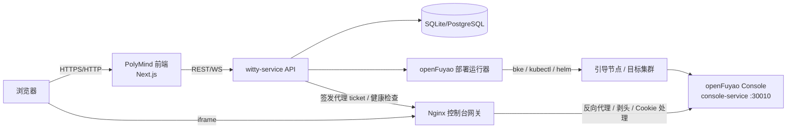

# openFuyao 自动化部署与右侧面板：现状评估与实施方案

> **状态：已被 [openfuyao-mvp-implementation-plan.md](openfuyao-mvp-implementation-plan.md) 取代（2026-10-19）。**
> 本文保留为评估背景，最终范围、架构与实施步骤以 MVP 方案为准。
>
> 评估对象：`polymind` 前端 `feat/auto-depoly`（相对 `master`）与 `witty-service` 后端 `feat/auto-depoly`。
> 评估时间：2026-10-19。
> 结论口径：以“用户从自定义 Agent 发起部署，部署完成后前端右侧面板可直接看到并操作 openFuyao 管理面”为验收目标，不以“能打开一个演示页”为目标。

---

## 0. 结论摘要

**需求可以实现，但不能按当前分支的“直接 iframe 内嵌控制台地址”路线实现。**

当前分支的完成度可以概括为：

| 能力 | 现状 | 判断 |
| --- | --- | --- |
| 右侧面板 tab / 面板壳 | 已新增 `openfuyao` tab、store、i18n、演示页 | 可复用 |
| Agent 流事件驱动打开面板 | 已新增 `openfuyao.open` 解析与回调 | 可复用，但契约要扩展 |
| 真实 openFuyao 控制台内嵌 | `iframe src=https://<node-ip>:30010` | **不可行**，会被 `X-Frame-Options: DENY` / CSP 拦截 |
| 控制台登录态 | 依赖 OAuth Cookie + 自签 TLS | **不可行**，跨域 iframe 会丢 Cookie / 证书报错 |
| 远程浏览器访问 | 控制台是内网/引导节点地址 | **不可行**，浏览器通常到不了该地址 |
| 自动化部署编排 | Agent 直接跑 `bash` / `bke` | 只能算 PoC，缺状态、幂等、恢复、审计 |
| 模板 skill 安装 | 修复前：6 个声明只装了 3 个；本地验证版已内置三个 openFuyao skill | 本地已修复，远端仍需合并/缓存 key 修复 |
| 部署结果持久化 | 只有 UI localStorage + 一个信号文件 | 不满足刷新/多 Agent/多部署 |

### 0.1 本地验证版进展（2026-10-19 15:20）

已先完成“只修 skill”的最小闭环：

- 三个 openFuyao skill 已内置到 `preset_agents/openfuyao-deployer/skills/`；
- `agent.yaml` 的这三个 skill 改为包内相对路径 `skills/...`，其余通用 skill 仍走远端缓存；
- 预置模板安装器优先解析包内 skill，内置 skill 缺失时直接失败（不再静默跳过）；
- `test_agent_template.py` 新增包内 skill 与无缓存安装用例；
- 后端全量单测：1746 passed / 8 skipped；
- 用临时模板别名实际走了一遍 `POST /agent-templates/{name}/instantiate`，新 Agent 的
  `.agents/skills/` 中 6 个 skill 全部存在（含三个 openFuyao skill）；
- 现有 `openfuyao-deployer` Agent 也已补齐三个 skill 并完成 DB sync。

> 这仍是“本地验证版”：远端合并时建议二选一：把三个 skill 合并进 `witty-agents` 上游仓库，或保留包内 skills 并同步修复 skill 仓库缓存 key（按 URL 区分，而不是只按仓库名）。

**建议的“推倒重做”范围：只重做控制台承载层（面板 iframe/URL/状态）和后端部署编排层；聊天流、右侧面板框架、事件分发骨架保留。**

一句话方案：

> 后端新增 openFuyao 部署域（部署记录 + 状态机 + 运行器 + API），前端右侧面板改为展示“部署记录 + 同源反向代理后的控制台”，事件只负责通知与进度，不再让 Agent 直接决定 iframe 的 URL。

---

## 1. 评估范围与方法

### 1.1 代码范围

前端 `polymind`：

- 分支：`feat/auto-depoly`
- 相对 `master`：6 个提交领先、1 个提交落后（`f47c43b`）
- 相对 `origin/feat/auto-depoly`：7 个提交领先、6 个落后（本地与远端需要对齐）
- 变更：17 个文件，约 +898/-8
- 关键提交：`6b3acac` 面板 tab、`624839a` 演示页、`5a645e4` 地址工具、`e909e56` store、`812ea10` 流事件、`8cf4a04` 类型补齐

后端 `witty-service`：

- 分支：`feat/auto-depoly`
- 本地相对 `origin/feat/auto-depoly`：3 个提交领先、1 个落后；其中 `863f19e` 是 openFuyao 模板，另外两个是 DSH 相关提交（`f747558`、`3e99445`），**分支内容混杂，合并前应拆分/变基**
- 关键变更：`openfuyao_detector.py`、`runtime_base.py` 的 `openfuyao.open` 事件、`preset_agents/openfuyao-deployer/agent.yaml`

### 1.2 验证方式

- 阅读前后端分支 diff 与关键调用链
- 运行前后端单测与类型检查
- 直接访问已部署的 openFuyao 控制台，检查响应头、OAuth 流程、TLS 证书
- 复盘 2026-10-19 11:33 那次真实部署的会话、工具调用、日志、信号文件、数据库事件
- 检查 `bke` / `kubectl` / 控制台 Pod 的实际状态

### 1.3 已执行的验证结果

| 验证项 | 结果 |
| --- | --- |
| 前端 openFuyao 相关单测 | 64 passed（`stream-event-handler` + `ui-store`） |
| 前端 `pnpm typecheck` | 通过 |
| 前端 ESLint（相关文件） | 0 error，7 个既有 `any` warning |
| 后端 openFuyao 单测 | 33 passed（`test_runtime_openfuyao_event` + `test_agent_template`） |
| 控制台首页 | `303 /rest/auth/login` |
| 控制台响应头 | `x-frame-options: DENY`、`content-security-policy: ... frame-ancestors 'none'` |
| 控制台 Cookie | `HttpOnly; Secure; SameSite=Lax/Strict` |
| 控制台 TLS | 自签证书，CN 为 `ingress-nginx-controller...`，与 IP 不匹配 |
| 控制台地址 | `https://192.168.122.146:30010`（内网/引导节点地址） |
| 集群 | k3s Ready，`openfuyao-system` 下 console-service / console-website 等 Pod Running |
| 真实部署会话 | 11:33 开始，12:06 该轮以 `error` 结束；信号文件 12:44 才出现 |
| `openfuyao.open` 落库 | 无；会话消息事件里也没有该事件 |
| 模板 skill 安装 | 声明 6 个，实际只装了 3 个；openFuyao 三个被日志明确跳过 |

---

## 2. 前端分支相对 master 的逐项评估

### 2.1 可保留的部分

| 文件 | 作用 | 评估 |
| --- | --- | --- |
| `lib/panel-tabs.tsx` | 注册 `openfuyao` tab、图标、i18n key | 保留 |
| `components/tool-panel/right-panel.tsx` | 面板注册表新增一行 | 保留 |
| `lib/agent-stream-events.ts` / `lib/stream-event-handler.ts` | 解析 `openfuyao.open` 并回调 store | 保留骨架，扩展 payload |
| `components/tool-panel/openfuyao/openfuyao-page.tsx` 的头部/空态/重载/外链 | 面板壳 | 保留 UI，替换 iframe 数据源与状态判断 |
| `locales/*/tool-panel.json` | 文案 | 保留并补充部署状态文案 |
| `lib/__tests__/stream-event-handler.test.ts`、`lib/stores/__tests__/ui-store.test.ts` | 单测 | 保留思路，改为新契约 |

### 2.2 必须重做/替换的部分

| 文件/实现 | 问题 | 处理 |
| --- | --- | --- |
| `openfuyao-page.tsx` 的 `iframe src={url}` | 控制台明确禁止被 iframe 内嵌 | 改为加载“同源反向代理 URL”，不再加载原始控制台地址 |
| `lib/openfuyao-console.ts` 的 `DEFAULT_CONSOLE_URL = DEMO_CONSOLE_URL` | 未配置时默认演示页，会掩盖真实故障 | 默认空态；演示页只作为显式“演示模式” |
| `lib/stores/ui-store.ts` 的单一 `openFuyaoConsoleUrl` + localStorage | 全局单例，切换 Agent/会话会串台；刷新后与后端状态不一致 | 改为按 `deployment_id` / `agent_id` 存储，并由后端记录 hydrate |
| `openfuyao-page.tsx` 用 `onLoad` 推导“已连接” | iframe 被拦截时 `onLoad` 也可能触发，显示假“已连接” | 状态由后端健康检查 + 代理健康接口决定；`onLoad` 只表示“已提交加载” |
| `openfuyao.open` 只带 `url` | 没有部署 ID、状态、阶段，无法区分是哪个部署 | 扩展为 `{deployment_id, url, status, phase}` |
| `parseOpenfuyaoOpen` 对任意 http(s) 地址放行 | 可被诱导加载钓鱼页/内网地址；后续代理还会引入 SSRF | 只接受后端签发的代理 URL；原始地址仅用于“在浏览器打开”且做 allowlist |
| `public/openfuyao-console.html`（演示页） | 仅演示，不能代表真实控制台 | 保留为开发演示，不作为生产默认 |

### 2.3 前端判断

- 作为“交互原型”，当前分支是合格的：tab、store、流事件、单测都齐。
- 作为“生产功能”，**控制台承载层需要推倒重做**。核心不是再调 iframe 参数，而是承认浏览器不能直接内嵌该控制台，必须引入服务端代理。
- 不需要重做聊天区、消息流、右侧面板整体框架；这些是资产。

---

## 3. 后端分支评估

### 3.1 已有内容

1. `openfuyao_detector.py`：识别 `write` 工具写出的 `.openfuyao/openfuyao-console.signal`，解析 `{"url": ...}`。
2. `runtime_base.py`：在 `tool.call.started` 缓存载荷，`tool.call.response` 且非错误时下发 `openfuyao.open`。
3. `openfuyao-deployer/agent.yaml`：预置模板，声明 6 个 skill、系统提示词、默认提问。
4. 单测：检测、失败写入不触发、非信号文件不触发。

### 3.2 关键缺陷

#### 缺陷 A：skill 仓库缓存按“仓库名”做 key，导致拉到错误的仓库

`resolve_skill_cache_dir()` 只用 `_repo_name_from_url()`：

```python
repo_name = self._repo_name_from_url(git_url)
return TEMPLATE_STORE_DIR / repo_name
```

`agent.yaml` 声明的是：

```yaml
skill_source:
  git_url: https://gitcode.com/ConneRa1/witty-agents.git
```

但本机缓存目录 `~/.witty/agent_templates/witty-agents` 里是 `openeuler/witty-agents` 的 clone。`ensure_skill_repo()` 只检查 `.git` 是否存在，存在就直接复用；`_prewarm_skill_repo()` 也是 `fetch` 当前 origin，不会切换 remote。

结果：模板指向的 fork 没有被使用，缓存里没有 openFuyao 三个 skill。

#### 缺陷 B：skill 找不到时只 warning，不失败

`_install_preset_skills()` 在 source 不存在时：

```python
logger.warning("Template skill source not found, skipping ...")
continue
```

模板实例化仍然成功，Agent 却在没有部署 skill 的情况下启动。真实日志：

```text
Copied template skill ... ssh-remote-sanitized
Copied template skill ... kubernetes
Template skill source not found, skipping: name=openfuyao-cluster-deploy
Template skill source not found, skipping: name=openfuyao-app-install
Template skill source not found, skipping: name=openfuyao-node-os-setup
Copied template skill ... experience-skill
```

实际只安装了 3 个 skill。`GET /agent-templates` 仍然返回 6 个，前端也以为模板完整。

#### 缺陷 C：按名称回退搜索的目录层级不对

`_find_skill_dir_by_name()` 只在 `cache_dir / "skills"` 下搜索，但实际路径是：

```text
cache_dir/openeuler-ops-agent/skills/openfuyao-cluster-deploy
```

所以即使 source 路径写错，回退也找不到。应改为全仓库 `**/<name>/SKILL.md`，并校验 `SKILL.md` 的 `name` 字段。

#### 缺陷 D：事件链路没有端到端闭环

真实会话里：

- 11:33:19 用户发出默认部署问题
- 11:39 回答了一个 `question.asked`
- 12:06:38 该轮 `turn.failed`，会话状态 `error`
- 12:44:58 信号文件才出现
- 数据库 `message_events` 中没有 `openfuyao.open`
- 前端没有收到过该事件

也就是说，当前“Agent 写信号 → 后端发事件 → 面板打开”的链路**没有被一次成功的 turn 验证过**。信号文件可能是后续补救/手工写入的。

#### 缺陷 E：历史回放丢 payload

`repositories.py` 的历史事件转换只为 `question.*`、`stream.error/client.error`、`artifact.*` 补了 `item["payload"]`，`openfuyao.open` 只保留 `type` 和 `timestamp`。刷新页面后即使读到该事件，也没有 `url`，无法恢复面板。

#### 缺陷 F：部署本身没有“服务端状态”

Agent 直接跑 `bke`，后端只知道“某个 tool call 成功/失败”，不知道：

- 现在处于 preflight / bootstrap init / cluster deploy / verify 哪个阶段
- 是否可重试、从哪一步恢复
- 控制台是否真的 ready
- 失败原因和日志在哪
- 是否有另一个部署正在进行

这导致前端只能显示聊天文本，不能显示可信的部署状态。

#### 缺陷 G：安全边界不足

- Agent 在 `local_process` 沙箱里拥有宿主 root 能力，可直接 `bke`、`dnf`、`ssh`、改 `/etc/shadow`。
- 真实运行中为满足 BKENode 的密码字段，设置过临时 root 口令并落盘。
- `opencode.json` 中模型 API Key 为明文。
- 信号文件里的 URL 没有 allowlist，后续若做代理会引入 SSRF。
- 没有部署确认令牌、命令审计、失败清理。

---

## 4. 真实部署复盘（证据）

### 4.1 时间线

| 时间 | 事件 |
| --- | --- |
| 11:33:19 | 创建会话，发送默认问题“帮我部署一套 openFuyao 环境...” |
| 11:33:22 | Agent 发现 skill 列表只有 3 个，开始自行查找 |
| 11:35 左右 | Agent 从 `ConneRa1/witty-agents` 手工 clone 到 `/tmp/opencode`，读到 openFuyao skill |
| 11:36 | 发现 `bke/kubectl/helm` 不在 PATH，下载并安装 `bke` |
| 11:39 | `bke init` 因 NTP（UDP/123）失败，改用 `--enableNTP=false` 重试 |
| 11:47 | 引导节点初始化成功，控制台部署，生成单节点集群模板 |
| 11:46-12:06 | 为 BKENode 设置临时 root 口令，准备拉起业务集群 |
| 12:06:38 | 该轮 `turn.failed`，会话进入 `error` |
| 12:44:58 | `.openfuyao/openfuyao-console.signal` 出现，内容 `{"url":"https://192.168.122.146:30010"}` |

### 4.2 当前实际状态

- `kubectl`（使用 `/etc/rancher/k3s/k3s.yaml`）可以看到节点 `Ready`。
- `openfuyao-system` 下 `console-service`、`console-website`、`oauth-server` 等 Pod 为 Running。
- 控制台 `https://192.168.122.146:30010` 可访问，返回 OAuth 登录跳转。
- 但默认 `~/.kube/config` 指向的 API Server 不可用，说明环境里有多个 kubeconfig，部署脚本/Agent 需要明确指定。
- 内存：8.6Gi 总量，约 7.3Gi 已用，可用约 1.3Gi；Pod 有多次重启。资源水位是后续自动化必须处理的风险。

### 4.3 结论

- “Agent 能在宿主上把 openFuyao 装起来”这件事**已经被证明可行**。
- “模板开箱即用、一次 turn 内自动完成、前端自动展示”**尚未成立**。
- 当前更像“人工/半自动 PoC”，不是可交付的自动化能力。

---

## 5. 核心阻塞分析

### B1. 控制台明确禁止 iframe 内嵌

```text
x-frame-options: DENY
content-security-policy: ... frame-ancestors 'none'; ...
```

这不是浏览器兼容性问题，是控制台的显式安全策略。只要 `iframe src` 指向原始控制台，浏览器就会拒绝渲染。当前面板会得到空白/错误页，且 `onLoad` 可能仍触发，导致“已连接”误判。

### B2. OAuth 登录态在跨域 iframe 中不可用

控制台登录流程：

```text
/rest/auth/login
  -> /oauth2/oauth/authorize?...
  -> /oauth2/auth/login/fuyaoPasswordProvider?...
```

响应设置：

```text
Set-Cookie: ...; HttpOnly; Secure; SameSite=Lax/Strict
```

在跨域 iframe 中：

- 直接 iframe 到 `https://<node>` 时，`Secure` 本身不是主要问题（iframe 自身是 https，可以写 Secure Cookie）；真正的阻塞是 `SameSite=Lax/Strict` + 第三方 Cookie 拦截 + OAuth 重定向；
- 如果后续用 http 代理（`http://<host>:3002`）承载，则上游的 `Secure` Cookie 在 http 页面下不会写入，必须剥离 `Secure`；
- 即使 Cookie 写入，OAuth 重定向的 `redirect_uri` 是 `/rest/auth/callback`，会跳回控制台根路径；在跨站 iframe 里，登录态无法按预期共享。

另外，控制台响应带 HSTS（`strict-transport-security`）。如果浏览器曾直接访问过 `https://<node>:30010`，再在同一 host 上用 http 端口做代理，浏览器可能把代理也强制升级为 https。代理最好使用独立 hostname（如 `localhost`）或直接使用 https，避免 HSTS 干扰。

### B3. 控制台是自签 TLS，且 CN 与 IP 不匹配

浏览器直接访问会证书告警；在 iframe 中用户无法点击“继续访问”，通常直接失败。服务端代理可以 `proxy_ssl_verify off`，浏览器只信任代理的证书/或使用 http 本地代理。

### B4. 控制台地址是内网/引导节点地址

信号文件里是 `https://192.168.122.146:30010`。如果用户在另一台机器通过 `http://localhost:3000`（端口转发）访问前端，浏览器无法路由到 `192.168.122.146`。直接 iframe 方案在远程访问场景下必然失败。

### B5. 没有部署状态模型

前端无法知道：

- 部署是否开始、到哪一步、是否可取消；
- 控制台是否 ready；
- 失败是 preflight、init、cluster 还是 console；
- 刷新后该恢复哪个部署。

只靠 Agent 文本和一次信号文件，无法做可靠 UI。

### B6. 事件/状态不持久、不闭环

- `openfuyao.open` 历史回放丢 payload；
- 面板地址是全局 localStorage；
- `rightPanelTabs` 不持久化；
- 没有 `deployment_id`，多 Agent/多部署会串台；
- 真实运行中没有落库的 `openfuyao.open`。

### B7. 模板 skill 安装有确定性 bug

见第 3 节缺陷 A/B/C。这个问题不修，换一台机器重新实例化模板，Agent 仍然拿不到 openFuyao skill，只能靠模型“自己找”，不可复现。

### B8. 安全与资源边界

- 宿主 root + 任意 shell；
- 临时 root 口令；
- 明文 API Key；
- 无部署确认/审计；
- 8.6G 内存下多 Pod 重启；
- 没有失败清理，可能留下半装集群。

---

## 6. 可行性判断

### 6.1 需求拆解

| 编号 | 需求 | 当前 | 结论 |
| --- | --- | --- | --- |
| R1 | 自定义 Agent 可发起 openFuyao 部署 | 模板/PoC 可用 | 部分满足，需产品化 |
| R2 | 自动完成引导节点 + 业务集群部署 | 手工/半自动跑通 | 不满足，需编排 |
| R3 | 部署完成后右侧面板展示控制台 | 仅演示页/被拦截 | 不满足，需代理重做 |
| R4 | 刷新/切换/多部署状态正确 | 全局单例 | 不满足 |
| R5 | 安全、可运维、可回滚 | 基本没有 | 不满足 |

### 6.2 技术路线对比

| 路线 | 能否满足 R3 | 评价 |
| --- | --- | --- |
| A. 直接 iframe 原始控制台 | 否 | XFO/CSP/Cookie/TLS/网络全部阻塞 |
| B. 新窗口打开 | 否 | 不在右侧面板内，不满足需求 |
| C. Electron `webview` / `BrowserView` | 仅桌面端 | 当前桌面壳明确禁用 webview；Web 场景不适用 |
| D. 截图/远程桌面流 | 勉强 | 交互差、成本高，不推荐 |
| E. 同源反向代理后 iframe | 是 | **推荐**；可剥头、改写 Cookie、屏蔽证书、复用登录态 |
| F. 推动 openFuyao 上游支持 iframe | 不确定 | 不受本项目控制，不能作为交付前提 |

### 6.3 “推倒重做”的边界

**建议重做：**

- 前端 `OpenFuyaoPage` 的数据源与 iframe 承载方式；
- 前端 URL 持久化模型（全局 → 按部署）；
- 前端“已连接”判定与部署状态展示；
- 后端新增 openFuyao 部署域（记录、状态机、运行器、API）；
- Nginx/网关的控制台代理；
- Agent 与后端之间的部署工具契约。

**建议保留：**

- 右侧面板 tab 注册、布局、i18n；
- 聊天消息流、工具调用渲染；
- `openfuyao.open` 的事件思路（扩展而非推翻）；
- 现有单测框架与演示页（仅开发用）。

---

## 7. 目标架构

### 7.1 总体结构



### 7.2 部署控制面

新增 `openfuyao` 领域，建议目录：

```text
src/witty_service/application/openfuyao/
  deployment_service.py      # 创建、确认、取消、查询
  deployment_runner.py       # bke 子进程、阶段解析、日志
  deployment_state.py        # 状态机 / 阶段枚举
  preflight.py               # OS/CPU/内存/磁盘/端口/NTP/依赖检查
  console_proxy.py           # 代理 ticket、健康检查、URL 签发
src/witty_service/api/openfuyao.py
src/witty_service/persistence/openfuyao_repository.py
```

如果不想新增目录，也可复用 `application/` 下现有服务模式，但建议独立，避免和聊天/渠道逻辑耦合。

### 7.3 数据模型

```text
openfuyao_deployments
  id                 TEXT PK
  agent_id           TEXT NOT NULL
  session_id         TEXT NOT NULL
  status             TEXT NOT NULL   -- pending|preflight|deploying|verifying|ready|failed|cancelled
  phase              TEXT NOT NULL   -- preflight|bootstrap_init|cluster_create|console_install|verify|done
  progress           INTEGER         -- 0-100
  console_url        TEXT            -- 原始控制台地址，仅后端/外链使用
  proxy_url          TEXT            -- 前端 iframe 使用的同源代理地址
  config_json        TEXT            -- 目标节点、集群名、选项（不含明文口令）
  error_code         TEXT
  error_message      TEXT
  created_at         TEXT
  updated_at         TEXT
  started_at         TEXT
  finished_at        TEXT
```

日志建议落文件而不是大字段：

```text
<workspace>/openfuyao/<deployment_id>/deploy.log
<workspace>/openfuyao/<deployment_id>/preflight.json
<workspace>/openfuyao/<deployment_id>/snapshot-before.txt
```

### 7.4 API 设计

```text
POST   /openfuyao/deployments
       body: {agent_id, session_id, target, options}
       -> 202 {deployment_id, status, plan_token}

POST   /openfuyao/deployments/{id}/confirm
       body: {plan_token}
       -> 202 {status}

GET    /openfuyao/deployments?agent_id=&session_id=
GET    /openfuyao/deployments/{id}
POST   /openfuyao/deployments/{id}/cancel
GET    /openfuyao/deployments/{id}/logs?cursor=
POST   /openfuyao/deployments/{id}/console-ticket
       -> {ticket, proxy_url, expires_at}
GET    /openfuyao/deployments/{id}/health
       -> {console_reachable, http_status, checked_at}
```

原则：

- 创建部署只生成计划，**不执行破坏性操作**；
- 用户确认后才进入 `preflight`；
- 所有状态变更写库并发事件；
- 取消要杀进程组并清理；
- 同一 Agent/主机默认只允许一个活跃部署，冲突返回 409。

### 7.5 事件契约

保留 `openfuyao.open`，新增 `openfuyao.deployment`：

```json
{
  "type": "openfuyao.deployment",
  "payload": {
    "deployment_id": "of-...",
    "status": "deploying",
    "phase": "bootstrap_init",
    "progress": 35,
    "message": "引导节点初始化中"
  }
}
```

```json
{
  "type": "openfuyao.open",
  "payload": {
    "deployment_id": "of-...",
    "url": "http://<frontend-host>:3002/",
    "console_url": "https://<bootstrap-ip>:30010",
    "status": "ready",
    "phase": "done"
  }
}
```

要求：

- `url` 必须是后端签发的代理地址，前端不得直接把 `console_url` 放进 iframe；
- 只有 `health` 通过后才发 `openfuyao.open`；
- `repositories.py` 历史转换要保留 payload；
- 前端历史加载时按 `deployment_id` 恢复，不重复弹面板。

### 7.6 控制台代理设计

推荐 **host/端口级反向代理**，不要用路径前缀。

原因：控制台是 OAuth + SPA，登录重定向是 `/rest/auth/callback`、`/oauth2/...` 这种根路径；路径前缀会破坏绝对路径和 `redirect_uri`。

MVP 形态：

```text
前端：http://<host>:3000
代理：http://<host>:3002  ->  https://<bootstrap-ip>:30010
iframe：http://<host>:3002/
```

关键要求：

1. **同站**：代理与前端必须同 host、同 scheme（端口可不同），否则 `SameSite=Strict/Lax` Cookie 在 iframe 中不发送。
2. **剥头**：

```nginx
proxy_hide_header X-Frame-Options;
proxy_hide_header Content-Security-Policy;
# 不能只留 frame-ancestors：上游 CSP 还含 connect-src/object-src，需同步保留
add_header Content-Security-Policy "connect-src 'self' https:; frame-ancestors 'self' http://<host>:3000; object-src 'none'" always;
```

> 注意：`X-Frame-Options` 不能改成 `SAMEORIGIN`，因为代理与前端不同端口即不同 origin；必须移除并由 CSP 的 `frame-ancestors` 精确放行前端 origin。
> 如果上游 CSP 后续增加指令，代理需要同步维护；建议加一条“响应头快照”回归测试。

3. **Cookie**：

```nginx
# 仅 http 代理需要：去掉 Secure，否则浏览器不写入
# 需要 nginx >= 1.19.3；旧版本用 proxy_cookie_path / 手动改写 Set-Cookie
proxy_cookie_flags ~ nosecure samesite=lax;
```

生产 https 代理可保留 `Secure`，但前端也必须是 https，否则同样写不进去。

> `SameSite=Strict` 的 `idpLogin_bke` 依赖“代理与前端同站”。如果代理换成不同站点，需要改为 `SameSite=Lax` 或改用 ticket 方案，否则登录会循环。

4. **自签证书与 Host**：

```nginx
proxy_ssl_verify off;
proxy_ssl_server_name on;
# 保持代理自己的 Host，避免上游把绝对跳转写回 192.168.x.x
proxy_set_header Host $host;
proxy_set_header X-Forwarded-Proto $scheme;
```

如果上游返回绝对地址（例如 `Location: https://192.168.x.x:30010/...`），需要 `proxy_redirect https://<bootstrap-ip>:30010/ /;`；否则浏览器会跳出代理。

5. **WebSocket / SSE**：

```nginx
proxy_http_version 1.1;
proxy_set_header Upgrade $http_upgrade;
proxy_set_header Connection "upgrade";
proxy_buffering off;
proxy_read_timeout 86400s;
proxy_send_timeout 86400s;
```

6. **认证**：代理不能成为开放入口。建议：

```text
前端 POST /openfuyao/deployments/{id}/console-ticket
  -> 后端返回一次性 ticket（60s）
iframe src = http://<host>:3002/__open?ticket=...
  -> 代理校验 ticket，设置 HttpOnly 会话 Cookie，302 到 /
  -> 后续请求由 auth_request 调后端校验
```

如果 MVP 先不做 ticket，至少：

- 代理只监听内网/本机；
- 加 IP allowlist；
- 不能把 3002 暴露到公网。

7. **多部署**：MVP 一台 witty-service 宿主机通常只有一个引导节点，代理可以固定一个 upstream；多主机/多部署时再按 `deployment_id` 生成 vhost 或端口，upstream 由后端配置，**不能由客户端传**（防 SSRF）。

### 7.7 前端面板改造

组件建议拆成：

```text
components/tool-panel/openfuyao/
  openfuyao-page.tsx          # 入口：当前 Agent 的部署列表/详情
  deployment-list.tsx         # 部署记录、状态、重试/取消
  deployment-status.tsx       # 阶段进度、日志、错误
  console-frame.tsx           # iframe + 代理 URL + 健康状态
  use-openfuyao-deployment.ts # 轮询/订阅/事件合并
```

Store 建议：

```ts
openFuyaoDeploymentsByAgent: Record<string, OpenFuyaoDeployment[]>
activeOpenFuyaoDeploymentId: string | null
openFuyaoConsoleByDeployment: Record<string, { proxyUrl: string; status: ... }>
```

不再使用全局 `pm_openfuyao_console_url` 作为唯一数据源；可以保留它作为“上次手动输入的地址”，但必须按 Agent/部署隔离。

状态展示：

| 状态 | UI |
| --- | --- |
| `pending` | “待确认”，展示影响面 + 确认按钮 |
| `preflight` | 检查项列表（OS/CPU/内存/端口/NTP/bke） |
| `deploying` | 阶段进度 + 实时日志 |
| `verifying` | “控制台启动中”，轮询 health |
| `ready` | 自动打开面板，iframe 加载代理 URL |
| `failed` | 错误码、日志、重试/清理 |
| `cancelled` | 已取消，可重新部署 |

“已连接”判定：

- 后端 `health` 返回 `console_reachable=true`；
- 代理返回 200/302 且响应头已被正确处理；
- iframe `onLoad` 只作为辅助，不作为唯一依据；
- 可在控制台页面注入 `postMessage` 握手（如果可改控制台），否则以 health 为准。

### 7.8 Agent 工具契约

推荐用 MCP 工具，而不是让 Agent 直接拼 shell：

```text
openfuyao.deploy(target, options) -> {deployment_id, plan_token}
openfuyao.confirm(deployment_id, plan_token)
openfuyao.status(deployment_id)
openfuyao.cancel(deployment_id)
openfuyao.console_url(deployment_id)
```

模板的 `agent.yaml` 增加 MCP server 声明；Agent 的提示词改为“先调用 `openfuyao.deploy` 生成计划，向用户确认后 `confirm`，轮询 `status`，ready 后由后端发事件”。

如果短期不做 MCP，保留 `write` 信号作为兼容路径，但后端必须：

- 校验信号文件所在 workspace 与 Agent 匹配；
- 将 URL 映射到部署记录；
- 用后端 health 确认后再发 `openfuyao.open`；
- 不允许信号文件直接决定任意 iframe URL。

---

## 8. 实施阶段与工作量

> 工作量按 1 名全栈 + 1 名后端估算；仅前端约 1-1.5 周。

### Phase 0：修复与可行性验证（2-3 天）

目标：先证明“代理后能内嵌 + 模板 skill 能装上”。

任务：

1. 修复 skill 仓库缓存 key（URL hash + repo name），校验 remote URL；`_find_skill_dir_by_name` 改为全仓库搜索；skill 缺失时实例化失败而不是跳过。
2. 在 `install-local.sh` / `start.sh` 的 nginx 模板增加 3002 控制台代理 server block（先硬编码单 upstream）。
3. 用真实控制台验证：浏览器 iframe 能显示登录页，登录后能进入控制台；检查 Cookie/TLS/WS。
4. 补一个集成测试：fake console 返回 `X-Frame-Options: DENY` + OAuth 跳转，代理后 iframe 可加载。

退出标准：

- `openfuyao-deployer` 实例化后 6 个 skill 全部存在；
- iframe 通过代理显示 openFuyao 登录页（截图/录屏）；
- 控制台登录可完成，刷新 iframe 不掉登录。

### Phase 1：控制台代理 + 面板 v1（4-6 天）

目标：把“能看”做稳。

任务：

1. 后端新增部署记录表/仓库/基础 API（先只读 + 手动登记）。
2. 代理 ticket/鉴权（至少 IP allowlist；生产做 ticket）。
3. 前端 `OpenFuyaoPage` 改为读取部署记录，iframe 加载 `proxy_url`；移除默认演示页；按 Agent 隔离。
4. 健康检查接口 + 状态展示；`onLoad` 不再直接判定 ready。
5. 外链按钮打开原始控制台（仅作为降级，不替代面板）。

退出标准：

- 切换 Agent 不会串台；
- 刷新后能恢复当前部署的面板；
- 代理不可达时显示明确错误，不显示“已连接”。

### Phase 2：部署编排（6-10 天）

目标：从“Agent 手工跑”升级为“可观测、可恢复的部署”。

任务：

1. `OpenFuyaoDeploymentService` + 状态机 + 运行器。
2. preflight：OS、CPU、内存、磁盘、端口、NTP、`bke/kubectl/helm`、镜像仓库连通性。
3. 阶段执行：安装 bke（校验和/离线包）、`bke init`、业务集群、控制台、验证。
4. 幂等/恢复：已有集群检测、阶段 checkpoint、失败重试、取消清理。
5. MCP 工具或后端工具 API；模板提示词改造。
6. 事件 `openfuyao.deployment` / `openfuyao.open` 落库与前端订阅。
7. 真实单节点 E2E。

退出标准：

- 干净 openEuler 机器，从聊天到面板可登录 ≤ 30 分钟；
- 任一步失败有阶段、错误码、日志、重试；
- 取消后无 orphan `bke` 进程；
- 同一 Agent 不会并发两个部署。

### Phase 3：产品化与安全（4-6 天）

任务：

1. 多部署/多主机（按 deployment 生成 vhost/端口，upstream 由后端固定）。
2. 代理 ticket、CSRF、审计、限流。
3. 资源 guard（最低内存/磁盘；低内存拒绝或要求确认）。
4. 安全整改：专用系统用户 + sudo 白名单；SSH key 替代 root 口令；日志脱敏；密钥轮换。
5. 回滚：`bke reset`/集群删除、快照、清理向导。
6. i18n、空态、错误文案、无障碍、移动端布局。

退出标准：

- 安全检查通过；
- 失败/取消/重试/回滚演练通过；
- 现有聊天/面板回归测试通过。

### 总工作量

| 阶段 | 工期 |
| --- | --- |
| Phase 0 | 2-3 天 |
| Phase 1 | 4-6 天 |
| Phase 2 | 6-10 天 |
| Phase 3 | 4-6 天 |
| 合计 | 约 3-4 周（1 全栈 + 1 后端） |

如果只要“可演示”：

- 修 skill（0.5-1 天）
- nginx 代理 + 前端指向代理（0.5-1 天）
- 按 Agent 存 URL（0.5 天）
- 约 2-3 天可做出“真实控制台在面板里可登录”的 Demo。
- 但这不是可交付的自动化部署，仍缺状态机、幂等、安全、回滚。

---

## 9. 验收标准

### 9.1 功能

1. 自定义 Agent 能发起部署计划，展示目标、影响面、回滚方案。
2. 用户确认后，面板显示 preflight/部署/验证阶段。
3. 部署完成后，右侧面板自动打开，iframe 显示 openFuyao 登录页。
4. 用户可在面板内完成登录并操作控制台。
5. 刷新页面后，面板恢复当前部署，不重复弹窗、不串台。
6. 切换 Agent，显示该 Agent 自己的部署；没有部署时显示空态。
7. 失败时显示阶段、错误码、日志；支持重试/取消。
8. 取消后进程/临时资源清理完成。

### 9.2 非功能

1. 干净环境部署 ≤ 30 分钟（单节点，网络/镜像可用）。
2. 代理后无 `X-Frame-Options`/CSP 控制台错误。
3. 控制台登录 Cookie 在 iframe 中可用，刷新不掉登录。
4. 代理未授权请求返回 401/403；不能作为开放代理。
5. 信号/日志不含明文口令、API Key、Token。
6. 低内存/端口占用/NTP 失败有明确提示，不进入半死状态。
7. 现有前后端测试全绿；新增代理/编排/事件测试。

### 9.3 必须覆盖的测试

| 类型 | 用例 |
| --- | --- |
| 单元 | 信号解析、事件 payload、状态机、URL allowlist、ticket 校验 |
| 集成 | fake console（XFO/CSP/OAuth/Cookie）+ nginx 代理 + iframe |
| 集成 | skill 安装：错误 repo/缺失 skill 必须失败 |
| E2E | 干净 VM 部署 → 面板 → 登录 → 刷新 → 取消/重试 |
| 安全 | SSRF、未授权代理、命令注入、日志脱敏 |
| 回归 | 聊天流、artifact、question、通知等既有事件不受影响 |

---

## 10. 风险与应对

| 风险 | 影响 | 应对 |
| --- | --- | --- |
| 控制台升级后重新加回 XFO/CSP | 面板再次白屏 | 代理统一剥头；加回归测试；监控响应头 |
| OAuth/Cookie 策略变化 | 登录循环 | 同站代理 + ticket；E2E 覆盖登录 |
| 自签证书/证书轮换 | iframe 失败 | 代理 `proxy_ssl_verify off`；或导入 CA |
| 内存不足 / Pod 重启 | 部署失败、控制台不可用 | preflight 资源 guard；最低 8G 可用；清理其他 Agent |
| NTP/网络不可达 | `bke init` 失败 | 预检 UDP/123；`--enableNTP=false` 兜底；记录 |
| BKENode 只支持密码 | 需要 root 口令 | 专用部署用户 + 密钥；若必须密码，用短期凭据 + 审计 + 轮换 |
| 多部署/多主机 | 代理 upstream 混乱 | upstream 由后端固定；按 deployment 生成 vhost/端口 |
| Agent 直接 root shell | 安全风险 | MCP 工具 + 专用用户 + sudo 白名单；禁止 LLM 拼 shell |
| 现有分支混杂 | 合并冲突/回滚困难 | 拆分 openFuyao 提交；前端 rebase master；后端剔除 DSH 提交 |

### 回滚策略

1. 部署前快照：节点、Pod、存储、网络、控制台 URL。
2. 失败时保留现场，不自动删除；提供“清理”按钮。
3. 清理顺序：业务集群 → 引导节点 → 控制台 → bke 临时文件。
4. 代理配置可独立关闭：关闭 3002 server block，前端回到空态，不影响聊天。
5. 数据回滚：部署记录软删除；不删聊天事件。

---

## 11. 待确认问题

在进入 Phase 1 前需要产品/架构确认：

1. **部署目标**：只支持 witty-service 所在宿主机单节点，还是要支持远程多节点/多集群？
2. **部署数量**：一个 Agent 一个环境，还是一台宿主只允许一个 openFuyao？
3. **访问形态**：只做 Web，还是桌面端也要内嵌？（桌面当前禁用 webview）
4. **控制台登录**：允许用户在面板内手动登录，还是要接 openFuyao OIDC/SSO 自动登录？
5. **代理部署**：是否允许修改 `install-local.sh` / `start.sh` 的 nginx 配置、额外开放 3002 端口？
6. **安全边界**：是否接受“专用系统用户 + sudo 白名单”替代当前 root shell？
7. **最低资源**：目标机器最低 CPU/内存/磁盘是多少？当前 8.6G 内存已出现 Pod 重启。

---

## 12. 建议的下一步（本周）

按优先级：

1. **P0：修 skill 安装**（后端 0.5-1 天）
   - 缓存 key 加 URL hash；
   - 校验 remote URL；
   - 全仓库回退搜索；
   - 缺 skill 直接失败；
   - 加集成测试。

2. **P0：代理 PoC**（1 天）
   - 在 nginx 增加 3002；
   - 剥 `X-Frame-Options`/CSP；
   - 处理 Cookie/TLS；
   - 用真实控制台验证 iframe 登录。

3. **P1：面板接代理**（1 天）
   - 去掉默认演示页；
   - `proxy_url` 由后端/配置提供；
   - `onLoad` 不再判定 ready；
   - 按 Agent 隔离 URL。

4. **P1：部署记录/API 骨架**（2-3 天）
   - 表 + 仓库 + 只读 API；
   - 事件落库；
   - 前端状态列表。

5. **P2：编排器**（1-2 周）
   - preflight、状态机、bke 执行、重试/取消、E2E。

---

## 13. 代码落点清单

### 前端（polymind）

```text
components/tool-panel/openfuyao/openfuyao-page.tsx     重做数据源/iframe
components/tool-panel/openfuyao/console-frame.tsx      新增代理 iframe + 健康状态
components/tool-panel/openfuyao/deployment-*.tsx       新增部署列表/状态/日志
lib/openfuyao-console.ts                               删除演示默认值，改为代理 URL 校验
lib/stores/ui-store.ts                                 按 deployment 存储
lib/stream-event-handler.ts                            扩展 openfuyao payload
lib/agent-stream-events.ts                             处理 openfuyao.deployment
lib/types.ts                                           EventItem/Deployment 类型
locales/{zh-CN,en-US}/tool-panel.json                  新增状态/错误文案
```

### 后端（witty-service）

```text
src/witty_agent_server/runtimes/openfuyao_detector.py  扩展 deployment_id/校验
src/witty_agent_server/runtimes/runtime_base.py        事件 payload 传递
src/witty_service/application/agent_template_service.py 修缓存 key/回退/失败策略
src/witty_service/data/preset_agents/openfuyao-deployer/agent.yaml 修 skill_source/加 MCP
src/witty_service/application/openfuyao/*              新增部署域
src/witty_service/api/openfuyao.py                     新增 API
src/witty_service/persistence/repositories.py          历史事件保留 payload + 新表
src/witty_service/main.py                              注册 router/启动恢复
```

### 部署/网关

```text
install-local.sh             nginx 模板增加 3002 控制台代理
start.sh                     代理生命周期/健康检查
Dockerfile / compose         若容器化部署，增加 nginx 或 sidecar
```

---

## 14. 附：当前分支合并建议

1. 前端 `feat/auto-depoly` 先 rebase `master`（当前落后 1 个提交），保持 6-7 个 openFuyao 提交独立。
2. 后端把 `863f19e` 与两个 DSH 提交拆开；openFuyao 分支只保留模板/事件/测试，避免把无关 DSH 变更带进 PR。
3. 与 `origin/feat/auto-depoly` 对齐（本地与远端各有提交），确认 `4b2756f` 与 `863f19e` 是否重复。
4. 合并前至少补齐：
   - 模板 skill 安装集成测试；
   - 事件落库/history 测试；
   - 代理 iframe E2E；
   - 真实部署 smoke test。

---

## 15. 最终判断

- **需求本身可行**：openFuyao 已经能在这台机器上部署起来，控制台也在运行。
- **当前前端分支的“直接 iframe”实现不可行**：不是代码写得不够，而是控制台的安全策略、OAuth、TLS、网络拓扑共同决定。
- **建议“推倒重做”的是控制台承载层和后端部署编排层，不是整个功能**。现有 tab、面板、事件骨架可以保留，但必须从“Agent 写 URL → iframe 打开”升级为“后端部署记录 → 代理 URL → 健康检查 → 面板展示”。
- 按本文 Phase 0-3 推进，约 3-4 周可以达到可交付状态；如果只做 Demo，2-3 天可以先验证“代理后真实控制台能在右侧面板登录”。
