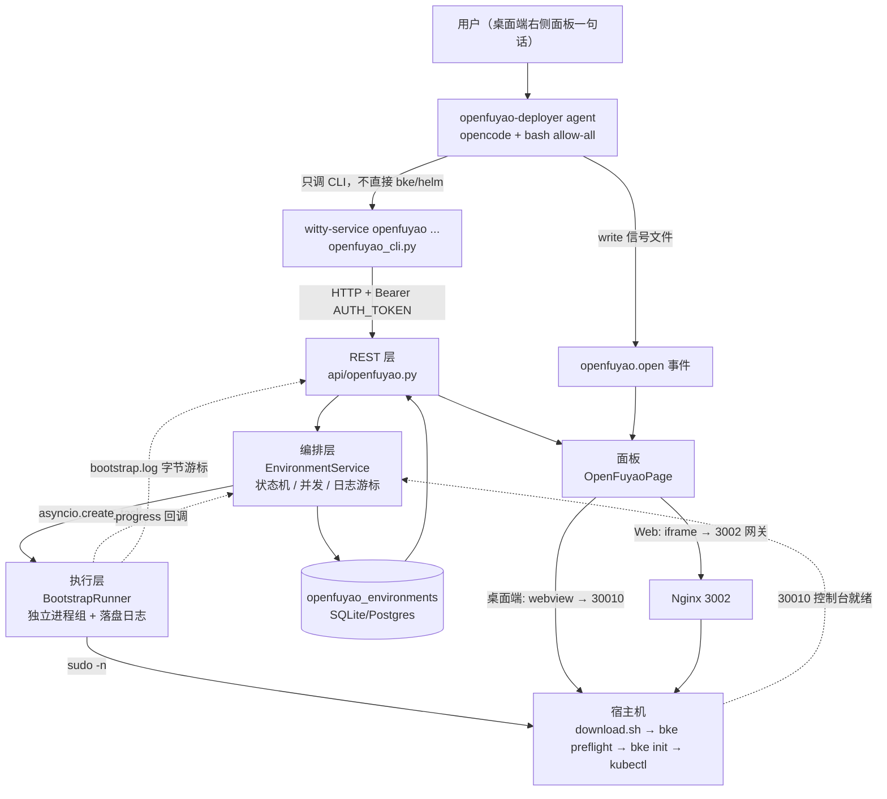
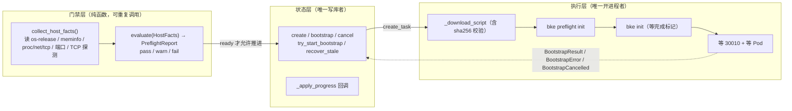
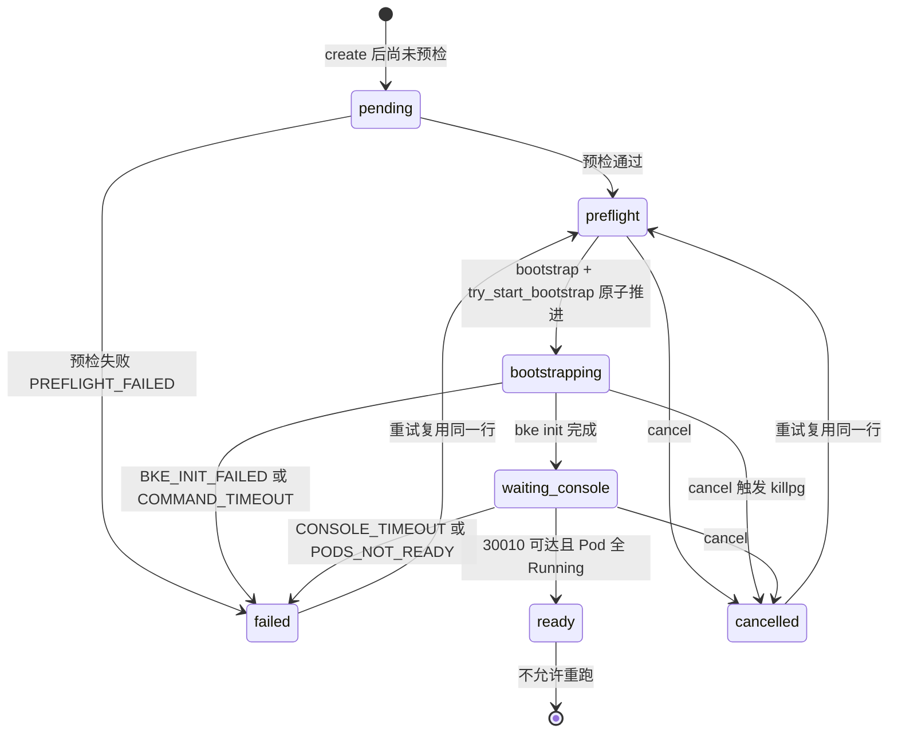
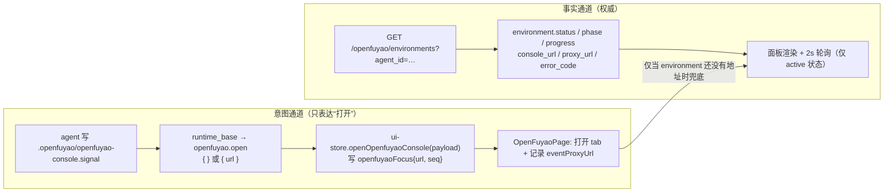
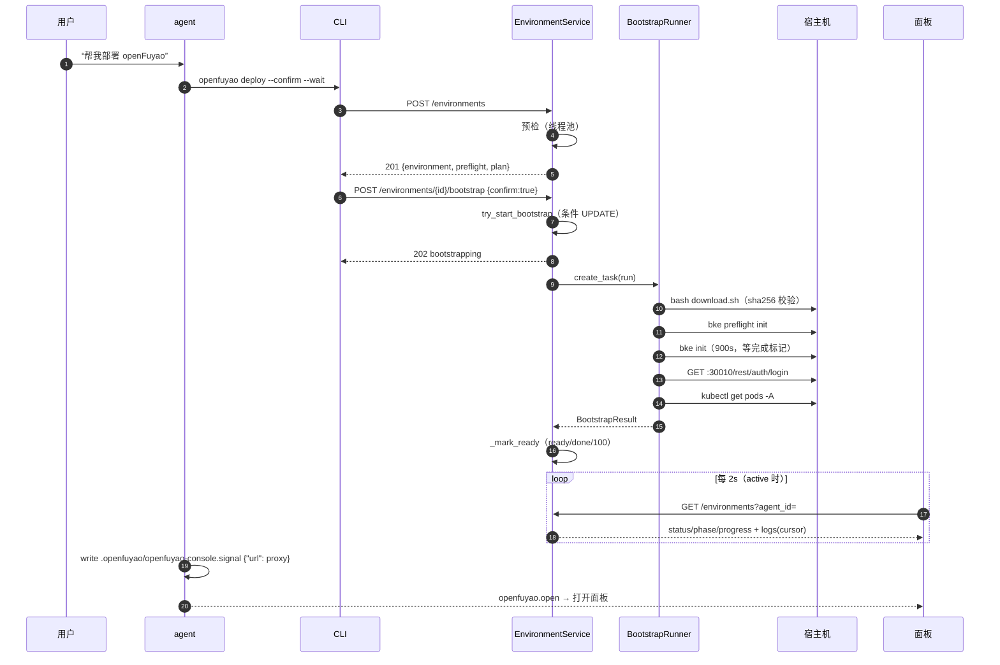
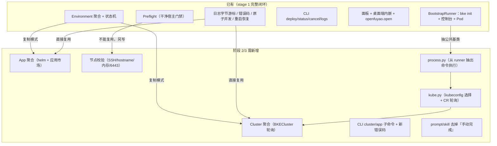

# openFuyao 分支变更评审与架构总览

> 目的：在动手做阶段 2/3 之前，先把 `feat/openfuyao-mvp` 相对 `master` 的实际产出讲清楚——
> 改了哪些**能力**（而不是哪些文件）、抽象设计是什么、实现逻辑怎么走、哪些地方是为阶段 2/3
> 预留的、哪些坑必须提前知道。
>
> 基线：`witty-service` / `polymind` 两仓库的 `feat/openfuyao-mvp` 分支。
> 采样时间：2026-10-20。相关方案：[openfuyao-stage2-stage3-automation-plan.md](openfuyao-stage2-stage3-automation-plan.md)、
> [openfuyao-stage2-stage3-run-20261020.md](openfuyao-stage2-stage3-run-20261020.md)。
>
> 证据等级约定：
> - **本轮复跑**：本文写作时实际执行过（命令与结果写在正文）；
> - **代码事实**：直接读分支代码得到；
> - **历史记录**：来自 `docs/*.md` 的记载，未在本轮重新验证。

---

## 0. 一页结论

1. 这两条分支合起来**只自动化了“阶段 1”：引导节点 + 控制台**。阶段 2（业务集群）、阶段 3
   （应用市场安装）**一行编排代码都没有**——运行时是用户在控制台里手动点的，代码里连
   `BKECluster` 这个字符串都不存在（本轮复跑：`grep -rn "BKECluster" src` 无结果）。
2. 真正的产出是**一套可复用的编排骨架**：`Environment` 聚合 + 状态机 + 原子并发控制 +
   独立进程组执行器 + 字节游标日志 + 结构化错误码 + CLI + REST + 前端面板 + 桌面端内嵌控制台。
   阶段 2/3 不是“从零写”，而是**在这套骨架上再长出两条聚合**（Cluster、App）。
3. 前后端之间有一条**双通道**契约，必须先理解再改：
   - **事实通道**：`GET /openfuyao/environments*` —— 状态、进度、地址的**唯一权威**；
   - **意图通道**：`openfuyao.open` 事件 —— 只负责“把面板打开/切到某个地址”，**不是**状态来源。
4. 承载端已经**分叉成两条路径**：Web = `iframe + Nginx:3002 网关`；桌面端 = `webview 直连
   https:30010`。两条路径**不能混用**，任何“控制台地址”的改动都要同时考虑两边。
5. 下一步（阶段 2/3）最大的风险不是写新代码，而是**复用错东西**——现有预检是“干净宿主门禁”，
   阶段 1 跑完后它必然失败；现有 CLI 的 `--confirm` 退出码语义与方案文档不一致。这两点已在
   2026-10-20 连同 §6.4 的复用清单一起修掉（见 §7 的“已修”标记与 §6.4 的实际落点）。

---

## 1. 变更规模与边界

### 1.1 分支拓扑

```text
witty-service（后端）
  master f747558 ──┬─ 34 commits ─▶ feat/openfuyao-mvp 425ca17   ← 当前 HEAD
                   └─  1 commit  ─▶ feat/auto-depoly   863f19e   （openfuyao agent 模板原型，本地比 origin 多 3 个提交）

polymind（前端）
  master f47c43b ──┬─ 14 commits ─▶ feat/openfuyao-mvp 927825d   ← 当前 HEAD
                   └─  6 commits ─▶ feat/auto-depoly   8cf4a04   （早期面板原型，含 public/openfuyao-console.html）
```

- `merge-base` 就是当前 `master`，两条分支**没有**落后，可以直接三方比对。
- `feat/auto-depoly` 是**先做的原型**：后端只贡献了 agent 模板 + 信号识别；前端当时用一张
  独立 HTML 页面做控制台面板。`feat/openfuyao-mvp` 是**把它整体取代**的实现，不要再参考
  `auto-depoly` 的前端。
- 后端工作区还有 1 个未跟踪文件 `docs/openfuyao-console-ux-assessment.md`（未提交）。

### 1.2 量化

| 仓库 | 提交 | 文件 | 增/删 | 生产代码 | 测试 | 文档 | 配置/脚本 |
| --- | --- | --- | --- | --- | --- | --- | --- |
| witty-service | 34 | 44 | +8078 / −9 | 22（含迁移、agent 模板） | 9 | 11 | 2 |
| polymind | 14 | 30 | +1726 / −22 | 19（含 i18n 2 份） | 3 | 1 | 7（桌面端 3 + 脚本/打包 4） |

删除量极小（后端 −9 行、前端 −22 行），说明这是**纯增量**分支：没有重写既有业务逻辑，只在
既有文件上做了约 10 处“接线”——

- 后端：`agent_manager`（注入 `WITTY_AGENT_ID`，2 处）、`main.py`（挂路由 + 启动恢复）、
  `api/services.py`（懒构造 + 关闭）、`cli.py`（子命令分流）、`persistence/{orm,db,repositories}.py`、
  `runtimes/runtime_base.py`（新事件类型）、`pyproject.toml`（包登记）；
- 前端：`right-panel` / `panel-tabs`（注册面板）、`chat-area`（传事件回调）、
  `ui-store` / `stream-event-handler` / `agent-stream-events` / `types`（新事件与打开动作）、
  `desktop/src/{main,preload}.js`（webview 与证书策略）。

这对合入是好消息（冲突面小），也意味着**回滚只需撤分支**。

### 1.3 十二个能力块（按“能力”而非“文件”切）

| # | 能力块 | 后端落点 | 前端落点 |
| --- | --- | --- | --- |
| 1 | 领域词表与边界决策 | `GLOSSARY.md`、`docs/adr/0001` | — |
| 2 | openFuyao 配置面 | `config.py::OpenFuyaoSettings` | `.env.example`（网关三变量） |
| 3 | 宿主机只读门禁 | `application/openfuyao/preflight.py` | — |
| 4 | Environment 聚合与持久化 | `domain/openfuyao.py`、`persistence/openfuyao_repository.py`、`orm.py`、迁移 `20261019_01` | — |
| 5 | Bootstrap 执行器 | `application/openfuyao/bootstrap_runner.py` | — |
| 6 | 控制台探活 | `application/openfuyao/console_health.py` | — |
| 7 | 编排服务（状态机/并发/取消/日志游标/重启恢复） | `application/openfuyao/environment_service.py` | — |
| 8 | REST API | `api/openfuyao.py`、`api/openfuyao_schemas.py` | `services/openfuyao-service.ts`、`lib/openfuyao-types.ts` |
| 9 | Agent 入口（CLI） | `openfuyao_cli.py` + `cli.py` 子命令分流 | — |
| 10 | Agent 侧集成 | `data/preset_agents/openfuyao-deployer/agent.yaml`、`agent_manager.py` 注入 `WITTY_AGENT_ID` | — |
| 11 | 信号事件 → 面板联动 | `runtimes/openfuyao_detector.py`、`runtime_base.py`、`persistence/repositories.py` | `stream-event-handler.ts`、`lib/stores/ui-store.ts`、`chat-area.tsx` |
| 12 | 承载端（网关 / 面板 / 桌面端） | — | `install-local.sh`、`start.sh`、`components/tool-panel/openfuyao/*`、`desktop/src/main.js` |

### 1.4 三次“形态收敛”（读代码前必须知道）

这个分支里有一半的提交是**否定前一个方案**，理解这条演进线比逐个读 commit 更省时间：

| 尝试 | 提交 | 为什么被放弃 |
| --- | --- | --- |
| ① iframe 地址跟随页面 host | `e7f8e5d` → 被 `c9f0203` revert | 想用“把 iframe 的 host 换成访问地址”解决端口转发下不可达。**没解决根因**：内嵌失败的真正原因是 `X-Frame-Options`/CSP 与跨站 Cookie，跟 host 拼什么无关 |
| ② 桌面端开独立控制台窗口 | `31b83bb` | 窗口里用的是**只接受 30010 的 IPC**，而按钮传的是 3002 网关地址 → “点了没反应”。而且独立窗口不满足“面板内看到控制台”的验收形态 |
| ③ 桌面端 webview 内嵌面板 | `2dc8648`（**当前形态**） | 取代 ②：`<webview>` 参与布局，能嵌在 tab 里；独立 guest 解决 SameSite；按端口放行证书解决自签。**② 的 IPC 代码已全部删除**（本轮复跑：`main.js` 里只剩 `mainWindow` 一个 `BrowserWindow`） |

外加前端 `feat/auto-depoly` 上的第 ④ 种尝试——`public/openfuyao-console.html` 整页 HTML——也被
组件化面板取代。四次尝试收敛成一句话：**控制台的“不可嵌入”是协议层问题，只能在承载端
（网关或 guest 进程）解决，不能在前端拼 URL 解决。**

---

## 2. 一句话架构与分层

**一句话**：Agent 只会说人话和敲 `witty-service`；所有特权动作都在后端，以 systemd 服务身份
经 `sudo -n` 白名单执行；Agent 只能看到结构化的状态、进度与错误码。



### 2.1 三条不可跨越的边界

| 边界 | 代码位置 | 为什么必须这样 |
| --- | --- | --- |
| Agent 不直接执行特权命令 | agent 模板 prompt + sudoers 白名单 | Agent 在沙箱里、无宿主 root；把破坏性动作关进后端才能做二次确认、错误码翻译和审计 |
| Runner 不碰数据库 | `bootstrap_runner.py` 模块 docstring 明写 | 执行器可以脱离 DB 单测（`test_openfuyao_bootstrap.py` 316 行全靠这一点） |
| Service 不直接开进程 | `environment_service.py` 只调 `runner_factory` | 状态机与执行解耦，将来换 Docker/K8s Job 执行器不用动状态机 |

### 2.2 依赖注入的三个口子

`EnvironmentService.__init__` 暴露了三个可替换点，这是这套代码**最值得复用到阶段 2/3 的设计**：

```python
runner_factory: RunnerFactory = BootstrapRunner,      # 执行器工厂（协议，非具体类）
preflight_runner: Callable[[], PreflightReport] = run_preflight,  # 门禁
agent_repository: AgentLookup                         # 只用来校验 agent 存在
```

`RunnerFactory` 是 `typing.Protocol`：只要求一个关键字参数签名，因此阶段 2 的
`ClusterRunner` 可以**不改 Protocol** 就塞进去。

---

## 3. 抽象设计（核心章节）

### 3.1 聚合根：为什么是 Environment，不是 Deployment

`GLOSSARY.md` 把 `Environment` 定义为“**一台宿主上的一个 openFuyao 管理面**，包含它的
Bootstrap Cluster、Console 和持有它的 Agent”。这个命名不是修辞：

- 如果叫 `Deployment`，语义是“一次部署动作”→ 天然允许多次、多版本，就要处理“上一次残留”；
- 叫 `Environment`，语义是“一个长期存在的环境”→ **一宿主一环境**变成数据库约束，
  `UniqueConstraint("host")` 直接兜底并发，业务上也不用回答“同一台机器能不能再来一次”。

代码里对此的表述（`orm.py`）：

> `host` 唯一是“一宿主一归属”的数据库约束：并发创建时由唯一索引兜底，服务层再把
> IntegrityError 翻译成 409。`agent_id` 不设外键，避免删除 Agent 时把环境与日志一起带走。

两条都值得记住：

- **唯一约束放在最底层**，服务层的 `get_by_host` 只是“提前给出好看错误”，不是并发正确性的来源；
- **不设外键**是刻意的：环境与日志要能在 Agent 删除后继续可追溯（运维资产 ≠ 用户资产）。

### 3.2 三层职责：门禁 / 状态 / 执行



三层的划分标准不是“代码放在哪个文件”，而是**副作用类型**：

| 层 | 副作用 | 可测性 | 失败表达 |
| --- | --- | --- | --- |
| 门禁 | 只读（系统调用、TCP 探测） | 构造 `HostFacts` 即可单测，不需要真机 | `PreflightCheck.status = fail` |
| 状态 | 只写 DB | 用 fake repository 单测 | `DomainError(code, status_code)` |
| 执行 | 只开进程/写日志 | 用 fake argv 单测 | `BootstrapError(code, phase, detail)` |

**为什么门禁要拆成“采集 + 评估”**：`collect_host_facts()` 返回一个 frozen dataclass
`HostFacts`，`evaluate(facts)` 是纯函数。这样“什么算不合格”这个**策略**可以穷举测试
（`test_openfuyao_preflight.py`），而不用在真机上造 8 核以下 / 90% 磁盘满的现场。

### 3.3 状态机



配套的四个常量集合（`domain/openfuyao.py`）是这段代码里**最该先读的 20 行**：

| 常量 | 成员 | 作用 |
| --- | --- | --- |
| `BOOTSTRAP_ALLOWED_FROM` | pending, preflight, failed, cancelled | 哪些状态允许**发起** Bootstrap。`ready` 不在内 → 天然幂等保护 |
| `CANCELLABLE_STATUSES` | preflight, bootstrapping, waiting_console | 哪些状态允许取消 |
| `TERMINAL_STATUSES` | ready, failed, cancelled | 前端轮询的终止条件、CLI 的 `_TERMINAL` |
| `PHASE_PROGRESS` | preflight 5 / install_bke 20 / bke_init 55 / wait_console 90 / done 100 | 进度是**阶段映射**，不是真实百分比 |

> **设计取舍**：进度用固定映射而不是“真实完成度”。理由是真实完成度无法从 `bke init`
> 的输出可靠推断，猜出来的百分比比“走到哪一步”更容易撒谎。代价是 UI 上会看到 55% 停很久
> （`bke init` 在本机约 4 分钟）。

### 3.4 并发与生命周期：四个必须看懂的机制

**(1) 并发创建：唯一索引兜底 + IntegrityError 翻译**

```text
两个请求同时 create_environment
  → 都过了 get_by_host（都是 None）
  → 都走到 insert
  → 一个成功，另一个抛 IntegrityError
  → HostAlreadyClaimedError → 服务层：同 agent 返回已存在行；不同 agent 抛 409 HOST_ALREADY_CLAIMED
```

**(2) 重复 bootstrap：条件 UPDATE 原子推进**（`try_start_bootstrap`）

```sql
UPDATE openfuyao_environments
   SET status='bootstrapping', phase='preflight', progress=5, started_at=now
 WHERE id=:id AND status IN ('pending','preflight','failed','cancelled')
```

返回 `rowcount == 0` 就说明“有人抢先了或状态不允许”→ 409 `BOOTSTRAP_IN_PROGRESS`。
**这一条比任何进程内锁都可靠**，因为它对多进程、多副本都成立。

**(3) 取消与完成的竞态**

`cancel()` 的顺序是：先让 runner 收到取消（SIGTERM 进程组）→ 再用 `asyncio.shield` 等 10s
任务收敛 → **最后再看一眼当前状态**：

```python
current = self._repository.get(environment_id)
if current is not None and current.status in (ready, failed):
    return current   # 已经落定的终态不被覆盖
return self._repository.update(..., status=cancelled)
```

这是 commit `507e0e2`（“取消与完成竞态时保留终态”）修的东西。同类问题在阶段 2/3 一定
会再出现（`bke cluster create` 一次 20 分钟，用户随时可能取消），**建议直接复制这个模式**。

**(4) 重启恢复**：`main.py` 的 startup 钩子调 `recover_stale()`，把 `bootstrapping /
waiting_console` 一律标 `failed / BOOTSTRAP_INTERRUPTED / “服务重启导致 Bootstrap 中断，可重新部署”`。
理由是进程内的 `_tasks` 字典随进程消失，前端若继续看到 “bootstrapping” 会永远转圈。
这个钩子用 `try/except` 整体包住，**失败不阻断服务启动**——增量能力不能成为启动的单点。

### 3.5 进程模型：为什么必须 `start_new_session=True`

```python
process = await asyncio.create_subprocess_exec(
    *argv, cwd=work_dir,
    stdout=PIPE, stderr=STDOUT,
    start_new_session=True,      # ← 关键
    env={**os.environ, "KUBECONFIG": settings.kubeconfig},
)
```

`bke init` 会 fork 一堆子进程（k3s、containerd、helm 调用）。如果只 kill 父进程，孤儿进程
会继续占端口、继续写 `/etc/kubernetes`，下一次重试就撞“宿主不干净”。因此取消是按**进程组**
回收：

```python
os.killpg(os.getpgid(process.pid), signal.SIGTERM)  # 先礼
# 5s 内不退出
os.killpg(os.getpgid(process.pid), signal.SIGKILL)  # 后兵
```

配合的还有两条：

- 每条日志行**同时**写文件（`bootstrap.log`）并留 200 行 `deque`，失败时 `detail=` 带最后
  200 行 → 错误信息自带现场；
- 每次 `run()` 开头 `self._log_path.write_text("")` **截断**日志——所以前端/CLI 重试时必须
  把游标归零（`openfuyao-page.tsx` 里 `cursorRef.current = 0` 那行就是为此）。

### 3.6 日志契约：字节游标而不是行号

`GET /logs?cursor=<byte>&limit_bytes=…` 返回 `{cursor, next_cursor, lines, eof}`。

- 用**字节偏移**而不是行号：文件被追加时行号会漂移，字节偏移是绝对位置；
- 只返回**完整行**：`end = chunk.rfind(b"\n") + 1`，半行留给下次（否则 UI 会出现截断的
  半条命令输出）；
- `eof` 是“当前读到的位置 ≥ 文件大小”，不是“进程结束”——前端靠状态字段判断是否继续轮询。

前端 `loadLogs` 还有一个容易踩的点（commit `4250701`）：轮询和状态刷新会**同时**触发日志
读取，两个请求带同一个 cursor 就会重复追加。解法是 `logsBusyRef` 串行化（`if (logsBusyRef.current) return`）。

### 3.7 错误即数据：三套错误码，别混用

| 层 | 载体 | 例子 | 谁消费 |
| --- | --- | --- | --- |
| 领域错误 | `DomainError(code, status_code, details)` | `HOST_ALREADY_CLAIMED` / `PREFLIGHT_FAILED` / `ENVIRONMENT_ALREADY_READY` / `CONFIRM_REQUIRED` | REST 客户端、CLI 的 `_ApiError` |
| 执行错误 | `BootstrapError(code, phase, detail)` | `BKE_DOWNLOAD_FAILED` / `BKE_CHECKSUM_MISMATCH` / `BKE_INIT_FAILED` / `BKE_INIT_INCOMPLETE` / `CONSOLE_TIMEOUT` / `PODS_NOT_READY` / `COMMAND_TIMEOUT` | 落库成 `error_code`/`error_message`，前端直接显示 |
| 进程退出码 | CLI `return int(...)` | `0` 成功 / `1` 参数或 API 错误 / `2` 预检未通过 / `3` 终态非 ready | Agent（`bash` 的 `$?`） |

Agent 侧的判据是**退出码 + `--json` 字段**，不解析人类可读文本。这也是方案 §4.2 的要求。

### 3.8 前端抽象：事实通道 vs 意图通道

这是前端设计里最容易被误解的一处，值得单独画出来：



关键代码（`openfuyao-page.tsx`）：

```ts
const proxyUrl = useMemo(() => {
  // 后端 Environment 是地址的权威来源；事件 URL 只在环境尚未拉回时兜底，
  // 避免 agent 写入任意地址就把 iframe 指过去。
  const fromEnvironment = resolveProxyUrl(environment, window.location.hostname)
  return fromEnvironment || eventProxyUrl || ''
}, [environment, eventProxyUrl])
```

**为什么不能只用事件**：事件是一次性的、可被 agent 任意构造的；把它当权威等于让 agent 决定
面板加载什么 URL（SSRF / 钓鱼面）。**为什么不能只用 REST**：`openfuyao.open` 的价值是
“不用刷新就让面板自己跳出来”，这是 UX 需求，REST 轮询做不到那么即时。

`seq` 字段（`ui-store.ts`）解决的是“同一个 url 连发两次事件”要不要重新拉取的问题——用自增
序号而不是对象身份，避免 store 里对象引用变化引发无限循环。

### 3.9 承载端分叉：为什么 Web 和桌面端必须两套

| | Web（3000） | 桌面端（`app://polymind`） |
| --- | --- | --- |
| 嵌入方式 | `<iframe src="http://<host>:3002/">` | `<webview src="https://127.0.0.1:30010">` |
| 为什么不能换 | 页面是 `http://`，可以直接 iframe 一个 http 网关 | `app://` 是**安全上下文**，嵌 `http://` 网关被混合内容拦 |
| 控制台直连行不行 | 不行：`X-Frame-Options: DENY` + 自签证书 | 不行，所以改 `<webview>`：独立 guest，按**顶层框架**加载 |
| Cookie | 网关改写 `Secure` → 无 Secure、`SameSite=Lax` | guest 自己的 session，`persist:polymind-console` 分区 |
| 证书 | 浏览器信任网关的 http，不需要 | 只对 30010 端口放行自签（`setCertificateVerifyProc` + `certificate-error` 双保险） |
| 安全约束 | Nginx CSP `frame-ancestors 'self' <前端源>` | `will-attach-webview` 校验 src 端口、剥 preload/Node、`sandbox:true` |

一句话记法：**Web 走“协议降级 + 网关改写”，桌面端走“guest 进程 + 按端口放行”**。
面板代码用 `window.polymindDesktop?.isDesktopShell` 二选一，两条路径**没有任何共享的地址
拼接逻辑**（这是刻意的，混用就会出 `ERR_CERT_AUTHORITY_INVALID` 或 `ERR_BLOCKED_BY_CSP`）。

---

## 4. 实现逻辑逐块

### 4.1 配置面：`OpenFuyaoSettings`

`config.py` 里 13 个配置项（对应 13 个环境变量），按用途分四组：

| 组 | 变量 | 影响什么 |
| --- | --- | --- |
| 来源 | `OPENFUYAO_BKE_DOWNLOAD_URL`、`OPENFUYAO_BKE_IMAGE` | 装哪个 BKE、拉哪个在线镜像（离线场景必须换） |
| 选址 | `OPENFUYAO_HOST`、`OPENFUYAO_CONSOLE_PORT`、`OPENFUYAO_PROXY_PORT`、`OPENFUYAO_PROXY_SCHEME` | 多网卡时指定宿主 IP；控制台/网关端口；网关协议 |
| 放行 | `OPENFUYAO_ENABLE_NTP`、`OPENFUYAO_ALLOW_UNSUPPORTED_OS` | `--enableNTP=false`；OS/内核矩阵失败时是否继续（26.09 例外） |
| 超时与路径 | `INIT_TIMEOUT`(900s)、`CONSOLE_TIMEOUT`(300s)、`KUBECONFIG`、`API_BASE_URL`、`WORK_DIR` | 卡死边界、kubectl 上下文、CLI 回连地址、日志目录 |

设计要点：`from_env()` 是**纯函数式**的，没有全局单例；`Settings.openfuyao` 带 `default_factory`，
所以老测试里 `Settings(...)` 的显式构造不会被打断。这是“增量改动不破坏既有测试”的一个具体做法。

> ⚠️ 生产上的实际值（`/etc/witty-service/witty-service.env` + drop-in）：`OPENFUYAO_ENABLE_NTP=false`、
> `OPENFUYAO_ALLOW_UNSUPPORTED_OS=true`、`OPENFUYAO_KUBECONFIG=/etc/rancher/k3s/k3s.yaml`。

### 4.2 预检：11 项检查，三档结论

| code | 判据 | 档位 |
| --- | --- | --- |
| `os` | 必须 `openeuler`；非 26.09 给 warn | fail / warn |
| `arch` | `x86_64` / `aarch64` | fail |
| `cpu` | < 8 核 fail | fail |
| `memory` | < 14 GiB 或可用 < 2 GiB → fail；< 16 GiB → warn | fail / warn |
| `disk` | 总 <50 或可用 <20 GiB → fail；<100 GiB → warn | fail / warn |
| `root` | root 或 `sudo -n -l bke` 可用 | fail |
| `tar` | `shutil.which("tar")` | fail |
| `clean_host` | 无 docker/k3s/containerd 命令，无 `/var/lib/rancher`、`/etc/rancher/k3s`、`/var/lib/docker` | fail |
| `ports` | 30010/6443/80/443 未被 LISTEN | fail |
| `network` | TCP 443 可达 OBS / `cr.openfuyao.cn` / `charts.bitnami.com` | fail |
| `ntp` | `timedatectl NTPSynchronized` | warn |

两个实现细节值得学：

1. **端口探测不 bind 特权端口**（commit `dae11a4`）。非 root 时 `bind(80)` 返回 `EACCES`，
   会被误判成“端口被占用”。正确做法是读 `/proc/net/tcp{,6}`，找 `st == 0A`（LISTEN）的行，
   从 `local_address` 里取十六进制端口。只有读不到 `/proc` 时才退回 bind。
2. **`is_root` 的名字是骗人的**：它其实调 `_has_privilege()`，非 root 时检查
   `sudo -n -l bke` ，即“能不能免密提权跑 bke”。这一项失败时给的文案是“需要 root 或可用的 sudo”，
   与实现一致。

> 🔴 **阶段 2/3 必读**：`clean_host` 与 `ports` 是**为“从零装引导节点”设计的门禁**。阶段 1 跑完后，
> `/etc/rancher/k3s` 必然存在 → `clean_host` 必然 fail。所以**阶段 2 的节点校验不能复用
> `run_preflight`**，要另写一套“节点就绪检查”（SSH 可达、hostname RFC1123、内存、磁盘、6443 空闲），
> 这正是方案 §5.2 第 2 条，但代码里还没有。

### 4.3 持久化：一张表 + 一个仓储

`openfuyao_environments`（16 列）：身份（`id/agent_id/host`）、状态（`status/phase/progress`）、
地址（`console_url/proxy_url`）、版本（`bke_version/os_version`）、诊断（`preflight_json/error_code/
error_message`）、时间（`created/updated/started/finished`）。

仓储 `OpenFuyaoRepository` 只有 7 个方法，但有两个细节：

```python
class _Unset: ...          # 哨兵
UNSET = _Unset()
def update(self, ..., status: str | _Unset | None = UNSET, ...):
    for key, value in candidates.items():
        if value is not UNSET:
            values[key] = value
```

**用哨兵而不是 `None`**，是为了区分“不改这个字段”和“把这个字段清空”。`_mark_ready` 要
`error_code=None`（清空），`_apply_progress` 只想改三列（不动 error）——没有哨兵就做不到。

迁移 `20261019_01` 有个额外动作容易被漏：`persistence/db.py::_handle_legacy_db_if_needed` 的
**必需对象清单**里要同步登记 `openfuyao_environments`，否则存量库会被判定“结构已完整”而
`stamp head`，新表永远不创建。这是这个仓库改造历史的特有约束（`test_db.py` 有对应断言）。

### 4.4 Bootstrap 执行器：五步

```text
run(preflight)
 ├─ preflight.ready? 否 → BootstrapError(PREFLIGHT_FAILED)
 ├─ _install_bke()
 │   ├─ _download_script()   httpx 拿 download.sh + .sha256，校验后写 0700
 │   ├─ bash download.sh     timeout 600
 │   ├─ bke version          → 记版本（⚠️ 见 7.1 缺陷）
 │   └─ bke preflight init   --onlineImage --hostIP --confirm
 │        └─ 非 0 且 OPENFUYAO_ALLOW_UNSUPPORTED_OS，且失败项**恰好**只有两张矩阵表 → 记 WARN 继续
 ├─ _bke_init()   bke init --onlineImage --hostIP --installConsole=true [--enableNTP=false] --confirm
 │                超时 900s，必须看到 "BKE initialization is complete"
 ├─ _wait_console()  每 5s GET https://<host>:30010/rest/auth/login，2xx/3xx 即算可达
 └─ _wait_pods()     kubectl get pods -A --no-headers，60s 内要求全部 Running/Completed
```

三个值得记的判断：

- **`bke init` 的失败判据是“完成标记”而不是退出码**。`bke init` 可能退出 0 但没装完，
  所以 `marker_seen` 与字符串包含**双判**（`not result.marker_seen and COMPLETE_MARKER not in
  result.output`）。阶段 2 的 `BKECluster` 轮询同理：**退出码只作参考，CR 才是真相**。
- **`_only_os_matrix_failure` 解析的是表格行**（含 `│` 且含“失败”，且恰好 2 行）。这是
  与 `bke` 输出格式的**强耦合**：`bke` 升级换表头就会失效。它只在 26.09 例外场景生效，属于
  可接受的临时妥协，但**必须写进“升级 BKE 前检查清单”**。
- **`_privileged()` 统一加 `sudo -n`**，root 下不加。`-n` 是“非交互”，拿不到免密就直接失败，
  不会卡在密码提示上把 API 进程挂死。

### 4.5 编排服务：一个类，两种“异步”

`EnvironmentService` 里有两类异步，别混：

| | 形态 | 例子 | 阻塞谁 |
| --- | --- | --- | --- |
| 请求内异步 | `await asyncio.to_thread(...)` | `create_environment` 里跑预检 | 只让出事件循环（预检是同步 IO，扔线程池） |
| 后台任务 | `asyncio.create_task(...)` | `bootstrap` 里 `_run_bootstrap` | 不阻塞请求，立即返回 202 |

`bootstrap()` 的返回是**刚推进到 bootstrapping 的行**（`self.get_environment(...)`），不是“完成
后的行”。这是 REST 语义：`POST /bootstrap` → `202 Accepted` + 当前快照，进度靠 `GET` 轮询。

`_runners` / `_tasks` 两个 dict 是**进程内状态**，也是这套实现最大的运维约束（见 7.2）。

### 4.6 REST 七个端点

| 方法 | 路径 | 语义 | 状态码 |
| --- | --- | --- | --- |
| POST | `/openfuyao/environments` | 预检 + 建环境（`dry_run` 只预检不落库） | 201 新建 / 200 复用 |
| GET | `/openfuyao/environments?agent_id=` | 列表（按 agent 过滤） | 200 |
| GET | `/openfuyao/environments/{id}` | 单条 | 200 / 404 |
| POST | `/openfuyao/environments/{id}/bootstrap` | 发起（必须 `confirm:true`） | 202 / 400 / 409 |
| POST | `/openfuyao/environments/{id}/cancel` | 取消 | 200 / 409 |
| GET | `/openfuyao/environments/{id}/logs?cursor=&limit_bytes=` | 日志分页 | 200 |
| POST | `/openfuyao/environments/{id}/health` | 控制台探活 | 200 |

`agent_id` 作为**查询参数**而不是从 token 推导，是 MVP 的简化：一个 Bearer token 能看所有
Agent 的环境。多租户时这是越权面，**阶段 2/3 加 Cluster/App 时建议把 `agent_id` 改成从 token
或从"当前会话"推导**，或至少校验“该 agent 属于当前调用方”。

`POST /health` 用 POST 而不是 GET 是因为它会主动向控制台发请求（有副作用语义），虽然实际
是只读的——这是沿用了“探针触发”的直觉，改起来不划算。

### 4.7 CLI：Agent 唯一的接口

命令树：

```text
witty-service openfuyao preflight                          # 只读门禁，不依赖后端
witty-service openfuyao deploy [--dry-run] [--confirm] [--wait] [--json]
witty-service openfuyao status [--wait] [--json] [--environment-id]
witty-service openfuyao cancel
witty-service openfuyao logs [--follow] [--cursor]
```

接入方式很省事：`cli.py::main()` 在解析 argparse 之前**先看 `sys.argv[1] == "openfuyao"`**，命中
就转给 `openfuyao_cli.main()`，否则原样走 uvicorn 启动。这样不用新增 console_script
（Agent 的 PATH 里已经有 `witty-service`）。

三个身份来源，优先级从高到低：

```text
--api-url  >  OPENFUYAO_API_BASE_URL  >  settings.openfuyao.api_base_url（默认 127.0.0.1:8000）
--token    >  AUTH_TOKEN（沙箱继承服务进程环境）  >  settings.auth_token
--agent-id >  WITTY_AGENT_ID（沙箱注入）  >  报错 AGENT_ID_REQUIRED
```

`WITTY_AGENT_ID` 的注入点在 `agent_manager.py` 两处 `sandbox_handle.start(...)`：

```python
env={**runtime_config.build_env(), "WITTY_AGENT_ID": agent_id}
```

> ⚠️ 这是一个**隐式契约**：CLI 的“我是谁”完全依赖沙箱注入。任何绕过 `AgentManager` 起沙箱的
> 路径（手工 docker run、测试容器）都会缺这个变量，CLI 会报 `AGENT_ID_REQUIRED`。

### 4.8 Agent 侧：模板 + 信号文件

**模板**（`data/preset_agents/openfuyao-deployer/agent.yaml`，75 行）定义了 agent 的名字、
6 个 skill、system prompt 和默认提问。关键在 prompt 里已经写好了“部署入口”：

```text
引导节点初始化统一走后端编排器，不要直接执行 bke init / bke reset：
    witty-service openfuyao deploy --confirm
命令会在后台启动并打印 environment_id；随后用短轮询跟踪……
```

但也**仍然保留**了这句（与阶段 2/3 方案 §6.1 冲突）：

```text
业务集群与应用市场安装由用户在官方控制台手动完成，不要声称已自动完成。
```

这两句现在是“自洽的”：stage 2/3 确实没做。做阶段 2/3 时必须**同批**改掉后半句，否则 agent
会拒绝调用新 CLI——这正是方案里说的“瓶颈不是 agent 不会用，而是 prompt 禁止”。

**信号文件 → 事件**（`runtimes/openfuyao_detector.py`）：

```text
agent 用 write 工具写 <任意目录>/openfuyao-console.signal
  内容 {}            → openfuyao.open { }            （只开面板，不改地址）
  内容 {"url": "..."} → openfuyao.open { url: "..." } （开面板并切地址）
  内容非法 JSON       → openfuyao.open { }            （回退“只开面板”，不让笔误把面板彻底打死）
```

为什么用**文件名**而不是扩展名/路径：路径不看目录层级（`PurePosixPath(...).name`），Agent
写 `~/.openfuyao/` 还是 workspace 根目录都命中。为什么不进 `artifact.*`：扩展名不在产物白名单，
它承担的是“开关”语义而不是“文件产物”。

事件下发时机（`runtime_base.py::_on_openfuyao_event`）与 artifact 同构：**started 阶段缓存载荷，
`TOOL_CALL_RESPONSE` 且 `is_error` 为假才下发**。一次失败的写入不会误开面板。

历史消息也要能恢复面板（`persistence/repositories.py`）：`openfuyao.open` 的 payload 被加进
“保留 payload”的 `elif` 分支，否则刷新后只剩 `type/timestamp`，地址就丢了。

### 4.9 前端面板：四个组件 + 一个数据层

```text
OpenFuyaoPage（编排：拉数据、轮询、分支渲染）
 ├─ EnvironmentStatus   顶部：状态点、host、状态文案、探活、进度条、主操作（部署/重试/取消）
 ├─ QuickStartChecklist ready 后：3 步清单（第 1 步由状态驱动，第 2/3 步人工勾选存 localStorage）
 ├─ PreflightList       预检未过时：逐项 pass/warn/fail + 汇总
 └─ 控制台               Web: ConsoleFrame(iframe) / 桌面端: ConsoleWebview(<webview>)
```

四个实现细节：

1. **按 Agent 隔离**：`useEffect` 依赖 `loadEnvironment`，切 Agent 时把 `envIdRef/cursorRef/
   logs/health` 全清空。不清就会“串台”——A 的环境显示在 B 的面板里。
2. **请求序号防乱序**：`requestSeqRef` 自增，回来时 `if (seq !== requestSeqRef.current) return`。
   快速切 Agent 时慢响应会覆盖新状态，这是低成本的标准解法。
3. **只在 active 状态轮询**：`preflight/bootstrapping/waiting_console` 每 2s，`ready/failed/
   cancelled` 不轮询。`loadEnvironment` 内部顺带拉日志，所以不能再并行调 `loadLogs`（注释明写）。
4. **`reloadKey`**：面板上的“刷新”按钮不是刷新页面，是给 iframe/webview 一个变化的 key 触发
   重新挂载/`reload()`。

`EnvironmentStatus` 的按钮逻辑值得单独记一下，因为它把状态机**翻译成了用户动作**：

| 当前状态 | 主按钮 | 文案 |
| --- | --- | --- |
| 无 environment | `deploy` → `createEnvironment` | “预检” |
| `preflight` | `deploy` → `startBootstrap` | “部署” |
| `failed` / `cancelled` | `deploy` → `startBootstrap`（复用同一行） | “重试” |
| active | 取消按钮 | “取消” |
| `ready` | 探活 / 刷新 / 外链 | — |

### 4.10 控制台网关：Nginx 3002 到底做了什么

这是 Web 端唯一能让控制台显示在 iframe 里的办法（ADR-0001 的决策）。它做四件事：

```nginx
proxy_hide_header X-Frame-Options;            # 控制台原本 DENY
proxy_hide_header Content-Security-Policy;    # 原本 frame-ancestors 'none'
add_header Content-Security-Policy
    "connect-src 'self' https: wss: ws:; frame-ancestors 'self' <前端源>; object-src 'none'" always;
proxy_cookie_flags ~ nosecure samesite=lax;   # 本地 http 页面写不进 Secure Cookie
proxy_redirect https://127.0.0.1:30010/ /;    # 上游绝对跳转拉回代理
proxy_ssl_verify off;                         # 自签证书
```

外加 WebSocket 升级（`Upgrade`/`Connection`）与 `proxy_buffering off`、86400s 超时（控制台有
长连接）。

`start.sh` 这边负责：生成配置（`sed` 替换 7 个占位符）→ `nginx -t` → 启动 → `curl /__of_health`
探活；端口 3002 被占用时**直接退出**而不是静默跳过（避免面板永远 502 却查不到原因）。
`install-local.sh` 负责写模板，并在模板里嵌入 `{{FRONTEND_ORIGIN}}`（`build_frontend_origins()`
会把 localhost/127.0.0.1/所有本机 IP 拼进 CSP 白名单）。

> ⚠️ CSP 是**字符串白名单**：换访问地址（比如从 3000 改成域名）时 `frame-ancestors` 不含新源，
> 表现是 iframe 白屏 + 控制台报 `Refused to frame`。改地址时务必同步 `OPENFUYAO_FRONTEND_ORIGIN`。

### 4.11 桌面端：五个约束点

`desktop/src/main.js` 新增约 207 行，全部围绕“安全地把控制台嵌进来”：

1. `webviewTag: true`（原来是 `false`，且显式阻止挂载）——现在**唯一**允许的 webview 是控制台；
2. `will-attach-webview` 校验 `normalizeConsoleUrl(params.src)`：只认控制台端口，**强制**改写成
   `https://127.0.0.1:<port>`，并设置 `persist:polymind-console` 分区、删 preload、关 Node、
   `sandbox/contextIsolation/webSecurity` 全开；
3. `setCertificateVerifyProc` 只对控制台端口 `callback(0)`，其余 `callback(-3)`；再加
   `app.on('certificate-error')` 兜底（某些组合下 verify proc 不先生效）；
4. `will-navigate`：控制台 guest 在控制台端口上的 https 站内跳转放行（登录/OAuth 回调可能是
   节点 IP 的绝对跳转，所以**按端口**而不是精确 origin 判断），其余仍交系统浏览器；
5. `webviewTag` 带来的权限面扩大用 `isConsoleContents()` 收口：权限白名单现在允许
   “可信主页面 **或** 控制台 guest”。

另外两处与 openFuyao 无关但同批修的桌面端问题（`927825d`）：Wayland 下 `show:false` 的窗口
可能**永远不触发 `ready-to-show`**，所以加了 800ms 兜底显示；第二实例抢锁失败后不能立刻
`app.exit(0)`（`second-instance` 是异步 socket 投递，太早退会让第一实例收不到事件），改成
延迟 600ms + `presentMainWindow()`（show→moveTop→focus→app.focus→置顶开关）。

### 4.12 测试布局

| 文件 | 行数 | 覆盖什么 |
| --- | --- | --- |
| `test_openfuyao_preflight.py` | 137 | `evaluate(HostFacts)` 全档位分支 |
| `test_openfuyao_environment_service.py` | 302 | 状态机、并发、取消竞态、重启恢复（fake repo/runner） |
| `test_openfuyao_bootstrap.py` | 316 | 执行器五步、超时、marker、sudo 前缀（fake 子进程） |
| `test_openfuyao_cli.py` | 159 | 命令分支与退出码（fake client） |
| `test_openfuyao_api.py` | 231 | 七个端点 + 鉴权 + 409/404 |
| `test_openfuyao_repository.py` | 161 | UNSET 语义、唯一约束、原子推进 |
| `test_runtime_openfuyao_event.py` | 143 | 信号识别、载荷回退、事件时机 |
| `test_db.py` / `test_repositories.py` | +61 | legacy 库判定、payload 保留 |

**本轮复跑**：

```bash
.venv/bin/python -m pytest -q tests/unit/test_openfuyao_*.py tests/unit/api/test_openfuyao_api.py \
  tests/unit/persistence/test_openfuyao_repository.py tests/unit/test_runtime_openfuyao_event.py \
  tests/unit/test_agent_template.py
# 136 passed（修复与拆件后；原 89 项基线）
```

历史记录（未复跑）：全量后端 1809 passed / 12 skipped；前端 376 passed + typecheck + build 通过。

---

## 5. 前后端契约：两条时序

### 5.1 首次部署（A1）



### 5.2 失败与重试（A4）

```text
bke init 失败 → BootstrapError(BKE_INIT_FAILED, detail=最后 200 行)
  → 落库 failed / error_code / error_message
  → 前端 EnvironmentStatus 直接显示 "BKE_INIT_FAILED: ..." + 日志区
  → 用户点“重试” → startBootstrap → 游标归零、日志清空
  → bootstrap() 再跑一次预检（@L275），失败就 PREFLIGHT_FAILED 直接返回，不浪费一次 bke
```

注意这里有个**隐含前提**：重试前预检会再跑一遍，而阶段 1 成功后 `clean_host` 必然 fail。所以
“重试”只对**失败过**的环境有意义（此时宿主还没装完），对 `ready` 的环境根本走不到——被
`ENVIRONMENT_ALREADY_READY` 挡住了。逻辑自洽，但**不要**顺手把 `ready` 加进
`BOOTSTRAP_ALLOWED_FROM`，那会让预检的 `clean_host` 变成一个假的阻断理由。

---

## 6. 与阶段 2/3 方案的对齐（决定下一步怎么干）

### 6.1 现状 vs 目标态



### 6.2 逐条对照

| 方案文档条目 | 现状 | 可复用 | 必须新增 | 风险 |
| --- | --- | --- | --- | --- |
| §4.1 `cluster create/status/logs` | ❌ 无 | CLI 骨架、`_ApiError`、`_poll` | 子命令 + 客户端方法 | 低 |
| §4.1 `app install/status` | ❌ 无 | 同上 | 子命令 + helm/market 封装 | 中（OCI 兜底复杂） |
| §4.2 `--json` 稳定字段 | 🟡 有 `id/status/phase/progress/error_code/error_message` | 直接沿用 | `verify_url`、`cluster_id` | 低 |
| §4.3 无 `--confirm` 退出码 2 | ✅ 已对齐（`d815d95`），见 §7.3 | `ExitCode` + `_finish` | 新子命令复用同一收尾 | 低 |
| §4.4 九个错误码 | 🟢 枚举已预留（`domain.ErrorCode`，`eb24833`），阶段 1 已全部接线 | `ErrorCode` | 阶段 2/3 抛码时直接引用，不再新增字符串 | 低 |
| §5.1 `openfuyao_clusters` / `openfuyao_apps` | ❌ 无 | ORM/仓储/迁移/legacy 清单的**全部套路** + `resource_state` 的条件占位/中断恢复 | 两张表 + 两个仓储 + 2 份迁移 | 中：`db.py` 必需对象清单别忘 |
| §5.1 两个状态机 | ❌ 无 | `domain/openfuyao.py` 的常量集合写法 | `ClusterStatus`/`AppStatus`/`PHASE_PROGRESS` | 低 |
| §5.2 阶段 2 七步 | ❌ 无 | 预检的“采集/评估”拆分、`_run_streaming` | 节点校验、yaml 渲染（0600）、CR 轮询、失败分类、受控清理 | **高**：hostname/静态 Pod/端口/镜像四类失败都要能定位 |
| §5.3 阶段 3 五步 | ❌ 无 | 日志/错误码/取消 | 市场 API 只读解析、`helm upgrade --install`、OCI 兜底、Pod/NodePort/HTTP 验证 | **高**：兜底链路最长，且依赖外部镜像源 |
| §6.1 prompt 去掉“手动完成” | ❌ 仍写着 | 模板结构 | 改 4 行 prompt | 低但**必须与后端同批** |
| §6.2 skill 改成“调 CLI” | ❌ 仍是 bke/helm 手册 | — | 改 `openfuyao-cluster-deploy` / `openfuyao-app-install` | 中：skill 在远端仓库 `witty-agents-test` |
| §6.4 sudoers | 🟡 已配 `bke`/`kubectl`/`download.sh` | — | helm 走后端（不经 agent）即可 | 低 |
| §7 A1-A4 验收 | 🟡 A1 已能跑 | 面板/事件/CLI | A2/A3 需要新能力 | — |

### 6.3 建议的代码落点（不改现有文件语义的加法）

```text
src/witty_service/
  domain/openfuyao.py                      + ClusterStatus / AppStatus / CLUSTER_PLAN / APP_PLAN / ErrorCode 枚举
  application/openfuyao/
    process.py                             ✅ 已存在（605211f）：CommandRunner，直接注入 cwd/env/log
    log_tail.py                            ✅ 已存在（1becfe1）：每资源一个 .log + /logs 分页
    kube.py                                ← 待写：kubeconfig 选择（管理 k3s vs 业务 admin.conf）、CR 轮询、nodes/pods 查询
    cluster_runner.py                      ← 阶段 2：渲染 yaml → bke preflight → bke cluster create → 轮询
    cluster_service.py                     ← 阶段 2 状态机（照抄 EnvironmentService 的骨架）
    app_runner.py                          ← 阶段 3：market 解析 → helm install → OCI 兜底 → 验证
    app_service.py                         ← 阶段 3 状态机
    helm.py / market.py                    ← 外部系统的薄封装（可注入，便于单测）
  persistence/
    resource_state.py                      ✅ 已存在（1c988c3）：UNSET / 条件占位 / 中断恢复
    openfuyao_clusters.py                  ← 待写：仓储（复用 resource_state，不再自造哨兵）
    orm.py                                 + OpenFuyaoClusterORM / OpenFuyaoAppORM
    db.py                                  + 两张新表登记进必需对象清单
  alembic/versions/2026102x_01_add_openfuyao_clusters_apps.py
  api/openfuyao_clusters.py / openfuyao_apps.py
  openfuyao_cli.py                         + cluster / app 两组子命令
```

**刻意不建议**的做法：把 Cluster/App 塞进 `EnvironmentService`。理由：`EnvironmentService`
已经有 503 行、7 个职责；再塞两条状态机就会变成 1500 行的“上帝类”，而且 `_runners/_tasks`
两个 dict 会需要按资源类型分键。**每个聚合一个 service，共享 `process.py` 和错误码**，是这套
骨架的正确长法。

### 6.4 复用清单（2026-10-20 已落地成代码，阶段 2/3 直接调用）

原清单是“实施时记得照抄”的口头约定；现在每一条都有对应模块，**照抄的动作已经省掉**：

| # | 清单项 | 落地位置 | 阶段 2/3 怎么用 |
| --- | --- | --- | --- |
| 1 | 条件 UPDATE 占位 | `persistence/resource_state.py::conditional_acquire` | `try_start_cluster(app_id, allowed_statuses=..., values=...)`，rowcount==0 → 409 |
| 2 | `UNSET` 更新哨兵 | 同上（`Unset` / `UNSET`），channel 仓储也已复用 | 新仓储的 `update_*` 直接用，别再定义第三份 |
| 3 | `start_new_session` + `killpg` | `application/openfuyao/process.py::CommandRunner` | `CommandRunner(cwd=..., log=..., env=...).run_streaming/run_capture` |
| 4 | 日志截断 + 字节游标 | `application/openfuyao/log_tail.py` | 每资源一个 `<work_dir>/<id>/cluster.log`，`read_log_page()` 出 `/logs` 分页 |
| 5 | 阶段→进度映射 | `domain/openfuyao.py::progress_for_phase(phase, mapping)` + `build_plan()` | 定义自己的 `CLUSTER_PLAN` 三元组，复用同一 `plan` 契约 |
| 6 | 中断恢复 + 启动钩子 | `resource_state.py::mark_interrupted` + `main.py` 的 startup 钩子 | 新 service 在 startup 里对“执行中”状态调一次 |
| 7 | 取消竞态“终态不覆盖” | `domain/openfuyao.py::is_terminal` + `EnvironmentService.cancel` 的模式 | 照抄 `cancel()` 的最后一段判断 |
| 8 | 错误三元组 `(code, phase, detail)` | `domain/openfuyao.py::ErrorCode`（含阶段 2/3 预留码）+ 各 runner | 抛 `BootstrapError(ErrorCode.HOSTNAME_INVALID, ..., phase=..., detail=...)` 同构错误 |
| 9 | `RunnerFactory` 协议 | `environment_service.py::RunnerFactory` | 只按签名传构造器，不新增 Protocol |
| 10 | `--json` + 退出码 + 幂等 | `domain/openfuyao.py::ExitCode` + `openfuyao_cli.py::_finish` | 新子命令复用 `_finish` 与 `ExitCode`，不要自定义退出码 |

仍在阶段 2/3 侧要做的只剩两件**业务**决定（不再是“照抄代码”）：

- [ ] Cluster/App 的 `allowed_statuses` / `ACTIVE_STATUSES` 集合定义（放进 `domain/openfuyao.py`）
- [ ] 每个新资源在 `main.py` 的 startup 恢复里登记一次

---

## 7. 已发现的问题与技术债

### 7.1 缺陷：`bke_version` 落库成了日志行（本轮复跑确认）

线上环境记录（只读查询 `/var/lib/witty-service/.witty/db/witty_service.sqlite3`）：

```text
id=f39868ab-…  status=ready  phase=done  progress=100
console_url=https://192.168.122.146:30010
proxy_url=http://192.168.122.146:3002/
bke_version={"time":"2026-10-20T15:36:12+08:00","level":"INFO","msg":"ologge   ← 64 字符被截断
os_version=26.09
```

根因：`_install_bke()` 返回 `_first_line(version.output)`，而 `bke version` 的**第一行是 JSON 日志**，
不是版本号。`_first_line` 又截断到 64 字符，于是数据库里躺着半条日志。
影响：面板顶部的 `bkeVersion` 会显示一段无意义文本（`openfuyao-page.tsx` 直接渲染）。

**已修**（commit `9bb0172`）：新增 `_parse_bke_version()` —— 跳过 JSON 行，优先读 `version:` 字段，
其次找非日志行里的语义化版本，都取不到返回 `None` 并记 WARN（宁可少一个字段也不写错数据）。
用本机真实输出校验：`bke version | _parse_bke_version` → `'latest'`。
顺带修了 `_wait_pods` 里 `"..." + _first_line(...)` 在空输出时的拼接崩溃。

> 存量污染数据（`bke_version` 已写成日志行的那些环境）不会自动修复，重建环境才会刷新。
> 这是阶段 2/3 的提醒：**任何解析 CLI 输出的地方都要有 fallback 与单测**。

### 7.2 运维约束：编排状态在进程内，多 worker 不安全

`EnvironmentService` 的 `_tasks` / `_runners` 是**进程内字典**，而 `witty-service` 支持
`--workers N`（默认 1）。当 N>1 时：

- `cancel()` 在没拿到 runner 的 worker 上不会真的杀进程（只能等 10s 超时后改状态）；
- 每个 worker 启动都会跑 `recover_stale()`，如果恰好有 env 在跑，会把别人的任务标成
  `BOOTSTRAP_INTERRUPTED`；
- `bootstrap()` 并发保护仍然有效（DB 条件 UPDATE），所以不会起两个 bke。

`channels/gateway.py` 有 `WORKER_COUNT_ENV` 守卫的先例，openFuyao **没有**。建议：
在 startup 里 `if workers > 1: logger.warning(...)`，或明确“openFuyao 只支持单 worker”并写进部署文档。

> 状态：**未修**（本次只覆盖 §7.1/7.3/7.4 与 §6.4）。多 worker 是部署形态问题，
> 需要先定“编排是否允许横向扩容”，再决定是加守卫还是把任务挪到外部队列。

### 7.3 契约不一致：无 `--confirm` 的退出码

方案 §4.3 要求“不带 `--confirm` 时只做预检并打印影响面，**退出码 2**”，原实现是：

```python
if not args.confirm:
    print("预检通过；加 --confirm 才会执行破坏性的 bke init。")
    return 0            # ← 而不是 2
```

而 `2` 被“预检未通过”占用了。两个语义撞在一起，Agent 无法区分“需要确认”和“预检失败”。

**已修**（commit `d815d95`）：退出码收敛到 `domain.openfuyao.ExitCode`，并写进 argparse epilog：

| 码 | 含义 |
| --- | --- |
| 0 | 成功；**含幂等**（已 ready / Bootstrap 已在跑都返回 0） |
| 1 | 执行错误（参数、API 不可达、业务 4xx/5xx） |
| 2 | 需要确认：预检通过但没带 `--confirm`（`--json` 里 `needs_confirm=true`） |
| 3 | 预检未通过：门禁失败，未执行任何特权动作 |
| 4 | 已到终态但不是目标态（`failed` / `cancelled`） |

同一提交还修了两个会直接坑到 Agent 的点：

- **幂等**：已 `ready` 直接退出 0 并给出现有 `proxy_url`；Bootstrap 已在执行则跟随，不重复启动；
- **`--json` 只输出一个文档**：原实现会先打 create 结果、再打 started、`--wait` 时还混入人类可读
  进度行，Agent 只能“取最后一段 JSON”。现在 deploy 输出统一信封
  `{exit_code, needs_confirm, summary, environment, preflight, plan}`。

### 7.4 `allow_unsupported_os` 的解析脆弱

`_only_os_matrix_failure()` 依赖 `bke preflight` 输出的表格字符（`│`、`失败`）与“恰好 2 行”。
`bke` 升级、语言从中文切英文、表格宽度变化都会让它静默失效（失效方向是**安全**的：变成不放行）。

**同步收紧了预检门禁的语义**（commit `307a5ed`）：把门禁拆成 bootstrap/node 两套，这条
`allow_unsupported_os` 的“矩阵例外”只在 bootstrap 门禁的 `bke preflight` 环节生效；
阶段 2 的节点校验改用 `Gate.node`，不再经过这段表格解析。

> 仍未改成 `--output json`：`bke preflight` 目前没有稳定的 json 输出，改成 JSON 需要先与
> BKE 侧确认字段；当前保留表格解析，但**失效方向是拒绝放行**，不会误放。

### 7.5 其它小项

| 项 | 位置 | 说明 |
| --- | --- | --- |
| `@app.on_event` 已废弃 | `main.py` | 本轮跑测试有 `DeprecationWarning`，将来 FastAPI 2 会移除 |
| `CONSOLE_PORT` 硬编码在桌面端 | `desktop/src/main.js` | 与后端 `OPENFUYAO_CONSOLE_PORT` 各写一份，靠环境变量 `POLYMIND_DESKTOP_CONSOLE_PORT` 对齐，容易漂 |
| 桌面端地址强制改写为 `127.0.0.1` | `normalizeConsoleUrl` | 多网卡/远端访问时语义变味（实际只支持本机） |
| `agent_id` 仅作查询参数 | `api/openfuyao.py` | 单 token 可跨 agent 读，多租户前必须收口 |
| skill 源指向 `witty-agents-test` | `agent.yaml` | 发版前要换回正式仓库（`feat/auto-depoly` 里是 `witty-agents.git`） |
| `preflight` 与 `bootstrap` 各跑一次预检 | `environment_service.py` | 两次结果可能不同（比如网络抖动），日志里会有两份报告；可接受但要知道 |

---

## 8. 名词与常识（做阶段 2/3 必须知道）

### 8.1 openFuyao 域

| 名词 | 含义 | 本项目里怎么用 |
| --- | --- | --- |
| **BKE** | openFuyao 的集群部署引擎（`bke` CLI），底层用 k3s 起管理面、用 CR 管理业务集群 | 后端以 `sudo -n bke` 调用；Agent **禁止**直接调 |
| **`download.sh`** | 官方 BKE 安装脚本（带 `.sha256`） | Runner 下载后校验 sha256，权限 0700 |
| **`bke init`** | 初始化引导节点，装管理 k3s + 控制台 + 仓库 | stage 1 的核心动作，完成标记 `BKE initialization is complete` |
| **`bke preflight init`** | 官方预检（46 项），含 OS/内核矩阵、端口、镜像源 | 与自研预检**并列**：自研在前（不依赖 bke），官方在后 |
| **`bke reset`** | 清理本机 k8s / 可选 `--all --mount` | ⚠️ **`--doc` 也会真 reset**（事故记录）；自动化里禁用 |
| **引导集群 / Bootstrap Cluster** | `bke init` 起的轻量 k3s，承载控制台与管理组件 | 端口 **36443**（不是 6443），kubeconfig `/etc/rancher/k3s/k3s.yaml` |
| **业务集群 / Business Cluster** | 从控制台创建、由 BKE CR 管理的 k8s | 端口 6443，kubeconfig `/etc/kubernetes/admin.conf` |
| **AIO** | All-in-One：引导集群与业务集群同机 | 本机就是 AIO，内存 18.39 GiB 是硬约束 |
| **`BKECluster` / `BKENode`** | 管理集群里的 CR，业务集群/节点的期望状态 | 阶段 2 的**真相来源**：退出码只作参考，轮询 CR 的 `ClusterReady/Healthy` |
| **`ClusterReady` / `Healthy`** | BKE 的状态条件 | 验收标准（方案 §7 A2） |
| **控制台 / Console** | 官方 openFuyao 管理 UI | 30010，自签 https，`X-Frame-Options: DENY`，OAuth 登录 |
| **Console Gateway** | 让浏览器在面板里够到 Console 的边界 | Web: Nginx 3002；桌面端: webview 直连 |
| **应用市场 / Marketplace** | 控制台的 chart 仓库管理（openFuyao / local / bitnami） | 阶段 3 只读解析；写入需 OAuth 服务凭据（MVP 不做） |
| **Manual Stage** | 由用户在控制台完成、Agent 不做的阶段 | 现在阶段 2/3 就是 Manual Stage —— 要改的正是这个定位 |

### 8.2 Kubernetes / Helm 域

| 名词 | 一句话 | 本项目的坑 |
| --- | --- | --- |
| **kubeconfig** | 访问集群的凭据文件 | 两个 kubeconfig 别混：管理 k3s `36443` vs 业务 `admin.conf`；`/root/.kube/config` 会被 BKE 改写 |
| **静态 Pod** | kubelet 直接读 `/etc/kubernetes/manifests` 起的 Pod | 名字含节点名：`etcd-auto-depoly`；**节点名带下划线 → kubelet 拒绝加载 → 控制面起不来**（真实事故） |
| **hostname RFC 1123** | 只允许小写字母/数字/`-`/`.`，不能有 `_` | `auto_depoly` → `auto-depoly` 是那次事故的修复 |
| **NodePort** | 把 Service 暴露到每个节点的固定端口（30000-32767） | 阶段 3 验证靠它：`32424` → 200 |
| **Ingress NodePort** | Ingress Controller 本身用 NodePort 暴露 | 业务控制台 `31616` 就是这么来的 |
| **CR / CRD** | 自定义资源 | 阶段 2 的轮询对象；`kubectl get bkecluster,bkenode -n bke-cluster` |
| **Helm release** | 一次 chart 部署实例 | 阶段 3 的单位；`helm upgrade --install` 天然幂等（方案要求的幂等靠它） |
| **chart / repo / OCI** | 打包格式 / HTTP 索引仓库 / registry 分发 | Bitnami 新 chart 走 OCI，本机被墙 → 走 `local` chartmuseum 中转 |
| **chartmuseum** | 业务集群本地 chart 仓库（`local-harbor`） | 兜底链路的落点 |
| **`global.security.allowInsecureImages`** | Bitnami chart 允许非官方 registry 镜像 | 不改就报镜像来源不允许 |
| **cgroup v1/v2** | Linux 资源控制层级 | 26.09 默认 v2 导致 BKE k3s 崩；改 `systemd.unified_cgroup_hierarchy=0` |
| **containerd** | 容器运行时（BKE 用 2.1.1） | 与 docker 冲突 → `clean_host` 要检 |

### 8.3 Web / 桌面端域

| 名词 | 一句话 | 本项目的坑 |
| --- | --- | --- |
| **`X-Frame-Options: DENY`** | 禁止被 iframe | 控制台默认有，网关必须 `proxy_hide_header` |
| **CSP `frame-ancestors`** | 谁能嵌我 | 网关改写为 `'self' <前端源>`；换访问地址要同步白名单 |
| **混合内容 / Mixed Content** | https 页面加载 http 资源被拦 | `app://` 是安全上下文 → 嵌不了 `http://…:3002` |
| **安全上下文** | `https`/`localhost`/`file`/自定义 scheme 等特权环境 | `app://polymind` 属于；决定桌面端必须走 https 直连 |
| **SameSite Cookie** | 跨站请求是否带 Cookie | iframe 跨站带不上 → 登录态丢；`<webview>` 按顶层框架加载 → 正常 |
| **`<webview>` vs `<iframe>`** | 独立 guest webContents vs 同源子框架 | webview 参与布局、有独立 session，但能力面大（必须主进程校验） |
| **`partition`** | Electron 的 session 隔离键 | `persist:polymind-console`，必须挂载前设置 |
| **`setCertificateVerifyProc`** | 自定义证书校验 | 只对 30010 放行；`callback(0)` 接受、`-3` 走默认 |
| **`--no-sandbox`** | 关闭 Chromium 沙箱 | root 下必须加（Electron 硬限制） |
| **Wayland `ready-to-show`** | 窗口首次可绘制的信号 | 无 surface 时可能永不触发 → 需要兜底显示 |
| **SSE / WebSocket** | 服务端推送 / 双向长连接 | 网关必须关 buffering、放大超时，否则流式对话卡住 |
| **字节游标** | 用字节偏移而不是行号定位 | 追加写安全；只返回完整行 |

### 8.4 本项目域

| 名词 | 含义 |
| --- | --- |
| **Environment** | 一宿主一个 openFuyao 管理面（+ 它的 Bootstrap Cluster + Console + 归属 Agent） |
| **Bootstrap** | 准备宿主 + 初始化 Bootstrap Cluster 的动作 |
| **Quick Start** | 三阶段：Bootstrap → 业务集群 → 应用 |
| **`openfuyao.open`** | 信号事件：只表达“打开面板/{url}”，不是状态 |
| **`WITTY_AGENT_ID`** | 沙箱注入的 agent 身份，CLI 靠它认领归属 |
| **`AUTH_TOKEN`** | 后端 Bearer token，沙箱继承服务进程环境 |
| **`proxy_url`** | Web 端 iframe 用的网关地址（`http://<host>:3002/`） |
| **`console_url`** | 控制台直连地址（`https://<host>:30010`），桌面端 webview 用 |
| **`verify_url`** | 阶段 3 缺的字段：应用装完后的可访问地址（方案 §4.2） |
| **Phase** | 阶段内的一步（`preflight/install_bke/bke_init/wait_console/done`） |
| **Progress** | 由 phase 映射的整数，不是真实完成度 |

---

## 9. 上手路线（约 65 分钟读完代码）

| 顺序 | 读什么 | 目的 | 时间 |
| --- | --- | --- | --- |
| 1 | `GLOSSARY.md` + `docs/adr/0001` | 先统一词，避免把 Environment 叫成“部署” | 5 min |
| 2 | `domain/openfuyao.py`（约 240 行） | 状态机常量、`ErrorCode`、`ExitCode` | 6 min |
| 3 | `application/openfuyao/preflight.py` 的 `evaluate()` / `evaluate_node()` | 两套门禁的差别 | 6 min |
| 4 | `application/openfuyao/process.py`（约 250 行） | 进程模型：独立会话、killpg、超时、日志泵 | 8 min |
| 5 | `application/openfuyao/bootstrap_runner.py` 的 `run()` | 五步执行与错误翻译 | 6 min |
| 6 | `application/openfuyao/environment_service.py` | 状态机、并发、取消、恢复 | 12 min |
| 7 | `persistence/resource_state.py` + `openfuyao_repository.py` | 条件占位与中断恢复 | 5 min |
| 8 | `application/openfuyao/log_tail.py` | 字节游标日志 | 3 min |
| 9 | `api/openfuyao.py` + `openfuyao_cli.py` | 契约的两端（含退出码收尾 `_finish`） | 6 min |
| 10 | `components/tool-panel/openfuyao/openfuyao-page.tsx` | 前端如何消费契约 | 5 min |
| 11 | `desktop/src/main.js` 顶部的注释块 | 桌面端为什么另起一套 | 3 min |

想快速跑起来验证：

```bash
# 只读门禁（不需要后端）
cd /root/witty-service && .venv/bin/python -m witty_service.openfuyao_cli preflight

# 单测（136 个，约 10s）
.venv/bin/python -m pytest -q \
  tests/unit/test_openfuyao_*.py tests/unit/api/test_openfuyao_api.py \
  tests/unit/persistence/test_openfuyao_repository.py \
  tests/unit/test_runtime_openfuyao_event.py tests/unit/test_agent_template.py

# 后端在跑的话，看当前环境
witty-service openfuyao status --agent-id 46083619-6933-440c-92c4-ae8570bc003b --json
```

---

## 10. 下一步建议（方案 A-F 的前置已就绪）

原先这里的三条建议（抽 `process.py`、先定错误码/退出码、拆 `clean_host`）已在 2026-10-20
落地，方案 §8 的阶段 A 事实上**已完成前置**。剩下的是业务实现本身：

1. **阶段 A 已可跳过“抽执行器”**：`process.CommandRunner`、`log_tail`、`resource_state`、
   `ErrorCode`/`ExitCode` 都在，直接写 `cluster_runner.py` / `cluster_service.py`。
2. **CLI 契约照 `_finish` + `ExitCode` 写**：`cluster create` 的“需要确认”必须复用 `ExitCode.CONFIRM_REQUIRED`
   （2），“预检未过”复用 3，“终态非目标”复用 4，不要另起一套。
3. **节点校验用 `Gate.node`**：`evaluate(facts, gate=Gate.node)` 已覆盖 hostname/内存/磁盘/6443，
   SSH 可达性在连接层补 `NODE_UNREACHABLE`。**不要**再复用默认 `bootstrap` 门禁——
   它在阶段 1 之后必然失败，这是预期行为，应写进部署文档。

验收上，方案 §7 的 A1-A4 我只看到 A1 有代码路径；A2/A3/A4 依赖第 6 章的新增项。建议在阶段 B
结束时先跑一次 **A2 的负例**（故意把 hostname 设成带下划线），验证 `HOSTNAME_INVALID` 这条
错误码链路是通的——这条链路一旦不通，A4“按错误码给下一步”就只是文案。
