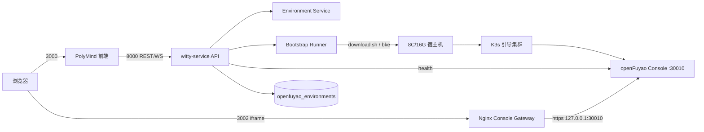

# openFuyao 快速入门 MVP 实施方案

> 状态：已确认，进入实施。
> 决策来源：2026-10-19 与需求方确认的 Q1-Q5。
> 背景评估见 [openfuyao-auto-deploy-plan.md](openfuyao-auto-deploy-plan.md)；本文是最终实施方案，评估稿仅作背景。

---

## 0. 已确认的范围

| 决策 | 结论 |
| --- | --- |
| MVP 自动化边界 | **只自动化阶段 1**：环境预检 + 安装 BKE + `bke init` + 控制台 ready + 打开面板 |
| 阶段 2/3 | 用户在右侧面板内嵌的官方控制台中**手动**新增业务集群、手动从应用市场安装应用 |
| 右侧面板形态 | **内嵌官方 openFuyao 控制台**；使用 Nginx 反向代理 |
| 代理 | **直接上 Nginx**，不引入 Node 网关；Nginx 配置作为独立 PR，但不阻塞前后端开发 |
| 部署目标 | 仅 witty-service 所在宿主机，单节点 AIO |
| 部署数量 | 一台宿主 = 一个 Environment = 一个 Agent 持有 |
| 访问形态 | 仅 Web |
| 控制台登录 | 用户在面板内手动登录；不代填、不存储密码 |
| 硬件 | 8C/16G，系统盘 ≥100G |
| OS | 保持 openEuler 26.09（注意：快速入门文档基线是 22.03，见风险） |
| “创建节点” | 等价于快速入门的“新增业务集群”：填写 Master/Node，创建一个单节点业务集群 |
| “安装应用” | 首版在控制台应用市场手动安装 nginx/apache；Phase 2 再做自然语言/应用市场 API |

**MVP 的一句话定义：**

> 用户在 PolyMind 里对一个 Agent 说“部署 openFuyao”，Agent 自动完成引导节点初始化和控制台部署，右侧面板自动打开代理后的官方控制台；用户随后在控制台里按快速入门手动新增单节点业务集群、手动从应用市场安装 nginx。

---

## 1. 快速入门与 MVP 的映射

| 快速入门阶段 | 文档动作 | MVP 由谁完成 | MVP 验收 |
| --- | --- | --- | --- |
| 0. 环境准备 | openEuler、root、tar、干净 OS、磁盘/网络 | 部署方预先准备 | 预检通过 |
| 1. 引导节点 | 下载并校验 BKE，`bke init`，等 Pod Running | **Agent + 后端编排器** | `BKE initialization is complete`，控制台可达 |
| 2. 业务集群 | 控制台“集群生命周期管理 → 新增集群”，填 Master/Node，选 openFuyao Cores，一键校验 → 创建 | **用户在面板控制台手动** | `ClusterReady`，集群状态“健康” |
| 3. 部署应用 | 控制台“应用市场 → 仓库配置”添加 Bitnami → 搜索 nginx/apache → 部署 | **用户在面板控制台手动** | 应用管理里发布 Running |

**不在 MVP 内：**

- 阶段 2/3 的后端自动化、自然语言创建集群/安装应用；
- 原生节点管理、BKENode 扩容/缩容；
- 应用市场 API、Helm 发布管理；
- 多节点/HA、离线安装、自定义仓库、证书、升级、回滚编排；
- 多 Agent/多 Environment、SSO、代理 ticket、桌面端。

---

## 2. 硬前提与不可妥协项

### 2.1 硬件与 OS

快速入门硬件表：

| 节点 | 数量 | CPU | 内存 | 磁盘 |
| --- | --- | --- | --- | --- |
| 引导节点 | 1 | 2 | 4G | 系统盘 ≥100G |
| 管理集群 | 1 | 8 | 16G | 系统盘 ≥100G |
| 业务集群 | 1 | 8 | 16G | 系统盘 ≥100G |

AIO 同机时，**最低 8C/16G**。当前 4C/8.6G 只能跑引导节点/控制台，不能可靠跑业务集群；继续在 4C/8G 上做“完整快速入门”会得到 Pod 重启和调度失败。

**结论：**

- 验收机必须是 **8C/16G、系统盘 ≥100G、干净 openEuler 26.09**。
- 4C/8G 机器只用于前端/后端开发，不作为 MVP 验收环境。
- 8C/16G 同时跑 openFuyao + PolyMind 偏紧；需要保留至少 2G 给 PolyMind/Next，部署前检查可用内存，建议 Demo 时停掉其他 Agent。

### 2.2 干净宿主机

快速入门明确要求：**不要预装 Docker/Kubernetes**，否则版本冲突。当前机器有 k3s、Docker、既有 openFuyao 残留，不能直接复用做“从零演示”。

**要求：**

- 使用新 VM 或干净快照；
- 或在演示前执行 `bke reset` 并清理 k3s/Docker 残留；
- 验收记录必须从“干净机器”开始。

### 2.3 同机运行 witty-service 的约束

部署目标是 witty-service 所在宿主机，但 `bke init` 会安装 k3s/containerd，并假设宿主机干净。需要明确：

- PolyMind 的 Agent 沙箱必须使用 `local_process`，不能依赖 Docker；
- 如果 witty-service 需要 Docker 沙箱，**同机目标不成立**，应改为“openFuyao 独立宿主机 + witty-service 远程管理”，或把 witty-service 放入独立 VM；
- 安装顺序：**先完成 openFuyao AIO，再启动 witty-service/Next**，避免 `bke init` 检测到 Docker/K8s 残留；
- 端口：PolyMind 3000/8000，openFuyao 30010/6443，Nginx 3002，互不冲突。

### 2.4 OS 26.09 的显式风险

快速入门基线是 **openEuler 22.03 LTS**；本方案按需求保持 **26.09**。26.09 内核 6.6 在支持矩阵内，且当前机器已跑通引导节点/控制台，但业务集群未闭环。

**Phase 0 必须做兼容性门禁：**

- 在 26.09 上完整走一遍快速入门，包含业务集群 + 应用市场装 nginx；
- 若 `bke init`、业务集群或控制台在 26.09 上失败，记录失败点并回退 22.03，不静默降级；
- 验收文档中明确“26.09 为已确认但非文档基线”的偏差。

---

## 3. 目标架构



**职责：**

- **Agent**：调用后端 `openfuyao.bootstrap` 工具，等待阶段 1 完成；不直接拼 `bke` 命令。
- **后端**：预检、下载/校验 BKE、执行 `bke init`、采集日志、轮询 Pod/控制台、写状态、发事件。
- **Nginx**：反向代理官方控制台，剥离禁止内嵌的响应头，处理 Cookie/TLS/WebSocket。
- **前端**：显示阶段 1 进度；ready 后加载代理 URL；提供阶段 2/3 的手动检查清单。
- **用户**：在面板控制台内完成业务集群、应用市场安装。

---

## 4. 领域模型

完整词表见 [GLOSSARY.md](../GLOSSARY.md)。MVP 只落地其中前三个实体。

| 术语 | 含义 | MVP 是否落地 |
| --- | --- | --- |
| **Environment** | 一台宿主上的一个 openFuyao 管理面，包含引导集群、控制台、归属 Agent | 是 |
| **Bootstrap** | 阶段 1：安装 BKE 并执行 `bke init`，产出 Console | 是 |
| **Console** | openFuyao 官方管理面（https://<host>:30010） | 是 |
| **Console Gateway** | Nginx 代理层，让 Console 能在右侧面板内嵌 | 是 |
| **Business Cluster** | 阶段 2 在控制台新增的单节点业务集群 | 手动，不建模 |
| **Node** | 业务集群的 Master/Node 机器 | 手动，不建模 |
| **Application** | 阶段 3 应用市场安装的 nginx/apache | 手动，不建模 |
| **Environment Owner** | 拥有该 Environment 的 Agent；一宿主一 Owner | 是 |

**MVP 数据表：**

```text
openfuyao_environments
  id                 TEXT PK
  agent_id           TEXT NOT NULL
  host               TEXT NOT NULL UNIQUE      -- 一台宿主一个环境
  status             TEXT NOT NULL             -- pending|preflight|bootstrapping|waiting_console|ready|failed|cancelled
  phase              TEXT NOT NULL             -- preflight|install_bke|bke_init|wait_console|done
  progress           INTEGER
  console_url        TEXT                      -- https://<host>:30010
  proxy_url          TEXT                      -- http(s)://<host>:3002/
  bke_version        TEXT                      -- 26.9.0
  os_version         TEXT                      -- 26.09
  preflight_json     TEXT
  error_code         TEXT
  error_message      TEXT
  created_at         TEXT
  updated_at         TEXT
  started_at         TEXT
  finished_at        TEXT
```

不建 `operations` 表：MVP 只有一个 Bootstrap 操作，Environment 状态足够；Phase 2 再做通用 Operation。

---

## 5. 后端设计

### 5.1 目录

```text
src/witty_service/application/openfuyao/
  environment_service.py      # 创建、查询、取消、归属校验
  preflight.py                # 快速入门前置检查
  bootstrap_runner.py         # BKE 下载/校验/bke init/等待
  console_health.py           # 控制台健康检查
  events.py                   # openfuyao.* 事件载荷
src/witty_service/api/openfuyao.py
src/witty_service/persistence/openfuyao_repository.py
src/witty_agent_server/mcp/openfuyao_server.py   # MCP 工具
```

### 5.2 API

```text
POST   /openfuyao/environments
       body: {agent_id, dry_run?: true}
       -> 201/202 {environment_id, status, plan}

GET    /openfuyao/environments?agent_id=
GET    /openfuyao/environments/{id}
POST   /openfuyao/environments/{id}/bootstrap
       body: {confirm: true}
       -> 202 {status: "bootstrapping"}
POST   /openfuyao/environments/{id}/cancel
GET    /openfuyao/environments/{id}/logs?cursor=
POST   /openfuyao/environments/{id}/health
       -> {console_reachable, http_status, proxy_url}
```

规则：

- `POST /environments` 只做预检和计划，不执行破坏性操作；
- `POST /bootstrap` 必须带 `confirm: true`；
- 同一 `host` 已有 Environment 时，其他 Agent 返回 `409 HOST_ALREADY_CLAIMED`；
- 同一 Environment 同时只允许一个 Bootstrap，重复请求返回 `409 BOOTSTRAP_IN_PROGRESS`；
- `cancel` 杀进程组，标记 `cancelled`，不自动 `bke reset`（清理需用户确认）。

### 5.3 状态机

```text
pending
  -> preflight
  -> install_bke
  -> bke_init
  -> wait_console
  -> ready

任意阶段 -> failed
pending/preflight/bootstrapping/wait_console -> cancelled
```

进度建议：

| 阶段 | 进度 |
| --- | --- |
| preflight | 0-15 |
| install_bke | 15-30 |
| bke_init | 30-80 |
| wait_console | 80-100 |
| ready | 100 |

### 5.4 预检清单

预检分两层：**快检**（不依赖 bke）+ **bke preflight**（BKE 安装后）。

快检：

| 检查 | 失败处理 |
| --- | --- |
| `/etc/os-release` 为 openEuler，VERSION_ID=26.09 | 警告/失败，明确偏差 |
| `uname -m` 为 aarch64/x86_64 | 失败，提示架构 |
| `nproc >= 8` | 失败；4C 机器提示不支持 AIO |
| `MemTotal >= 16G`，可用内存 >= 14G | 失败/要求确认；PolyMind 同机时保留 2G |
| 系统盘可用 >= 100G | 失败 |
| root 或 sudo 可用 | 失败 |
| `tar` 已安装 | 失败，给出 `dnf install -y tar` |
| 无 Docker/K8s 残留（`docker info`、`k3s`、`kubectl`、`containerd`） | 失败，给出清理指引 |
| 端口 30010/6443/80/443 未被占用 | 失败 |
| 到 OBS、`cr.openfuyao.cn`、`charts.bitnami.com` 可达 | 失败 |
| NTP/chrony 可用；UDP/123 可达 | 警告；允许 `--enableNTP=false` 兜底 |

BKE 安装后：

```bash
bke preflight init --onlineImage cr.openfuyao.cn/openfuyao/bke-online-installed:26.9.0 --confirm
```

解析 `bke preflight` 报告（JSON/HTML/终端）为结构化检查项；FAIL 阻止继续，WARN 要求用户确认。

### 5.5 Bootstrap 执行

```text
1. 下载 download.sh + .sha256
2. sha256sum -c
3. chmod +x download.sh && ./download.sh
4. bke version 校验为 26.9.0
5. bke preflight init ... --confirm
6. bke init --onlineImage cr.openfuyao.cn/openfuyao/bke-online-installed:26.9.0 --confirm
   （NTP 不可达时追加 --enableNTP=false，并在 UI 明示）
7. 轮询日志直到 "BKE initialization is complete" 或超时（15 分钟）
8. 轮询 kubectl get pod -A，直到所有 Pod Running/Completed
9. curl -k -I https://127.0.0.1:30010/rest/auth/login，接受 200/302
10. 写 status=ready，发 openfuyao.open
```

实现要点：

- 使用 `asyncio.create_subprocess_exec`，`start_new_session=True`，取消时杀进程组；
- stdout/stderr 落 `<workspace>/openfuyao/<env>/bootstrap.log`，按行推送到内存环形缓冲，供 `/logs` 读取；
- `kubectl` 必须显式 `KUBECONFIG=/etc/rancher/k3s/k3s.yaml`，不依赖用户默认 kubeconfig；
- 超时/失败保留现场，不自动删集群；
- 日志脱敏：不记录密码、Token、API Key；`bke` 输出中的敏感字段过滤。

### 5.6 控制台健康检查

```text
GET https://127.0.0.1:30010/rest/auth/login
  - 200/302 视为可达
  - 证书校验关闭（自签）
  - 5s 超时，3 次重试
```

代理健康可由 Nginx `/__of_health` 或后端直接检查 upstream；前端以 `/health` 返回为准，不用 iframe `onLoad` 判断。

### 5.7 事件契约

```json
{
  "type": "openfuyao.stage",
  "payload": {
    "environment_id": "of-...",
    "status": "bootstrapping",
    "phase": "bke_init",
    "progress": 55,
    "message": "引导节点初始化中"
  }
}
```

```json
{
  "type": "openfuyao.open",
  "payload": {
    "environment_id": "of-...",
    "url": "http://<host>:3002/",
    "console_url": "https://<host>:30010",
    "status": "ready"
  }
}
```

要求：

- `url` 必须是代理 URL，前端不得把 `console_url` 直接放进 iframe；
- 只在控制台健康检查通过后发 `openfuyao.open`；
- `repositories.py` 历史事件转换保留 payload；
- 前端刷新后通过 `GET /environments` 恢复，不依赖事件重放。


---

## 6. Nginx 控制台网关

### 6.1 为什么选 Nginx

- `bke init` 后控制台在 `https://<host>:30010`，带 `X-Frame-Options: DENY`、CSP `frame-ancestors 'none'`、OAuth Cookie、自签 TLS；
- 必须有一个反向代理来剥头、处理 Cookie/TLS/WebSocket；
- Nginx 已在 `install-local.sh` 的部署路径里，直接复用，不引入新进程；
- 单宿主 AIO 的 upstream 固定为 `https://127.0.0.1:30010`，不需要动态发现。

### 6.2 端口与 upstream

```text
前端：http://<host>:3000
代理：http://<host>:3002  ->  https://127.0.0.1:30010
iframe：http://<host>:3002/
```

生产 https 时，3002 也监听 https，并保留 `Secure` Cookie；前端也必须是 https。

### 6.3 配置

```nginx
server {
    listen 3002;
    server_name _;

    location / {
        proxy_pass https://127.0.0.1:30010;
        proxy_ssl_verify off;
        proxy_ssl_server_name on;

        # 保持代理自己的 Host，避免上游绝对跳转回 127.0.0.1
        proxy_set_header Host $host;
        proxy_set_header X-Forwarded-Proto $scheme;
        proxy_set_header X-Real-IP $remote_addr;

        # 允许被前端 iframe 内嵌
        proxy_hide_header X-Frame-Options;
        proxy_hide_header Content-Security-Policy;
        add_header Content-Security-Policy "connect-src 'self' https:; frame-ancestors 'self' {{FRONTEND_ORIGIN}}; object-src 'none'" always;

        # 本地 http 代理：去掉 Secure，否则浏览器不写入
        # 生产 https 改为 proxy_cookie_flags ~ samesite=lax;
        proxy_cookie_flags ~ nosecure samesite=lax;

        # WebSocket / SSE
        proxy_http_version 1.1;
        proxy_set_header Upgrade $http_upgrade;
        proxy_set_header Connection "upgrade";
        proxy_buffering off;
        proxy_read_timeout 86400s;
        proxy_send_timeout 86400s;

        # 上游若返回绝对地址，拉回代理
        proxy_redirect https://127.0.0.1:30010/ /;
    }
}
```

`{{FRONTEND_ORIGIN}}` 在 `install-local.sh` 中生成，至少包含：

```text
http://localhost:3000
http://<host-ip>:3000
https://localhost:3000
https://<host-ip>:3000
```

如果前端通过域名访问，把域名加入 `FRONTEND_ORIGIN`。

### 6.4 安全限制

MVP 不做 ticket，但代理不能是完全开放的公网入口：

- 3002 只对前端用户所在网段开放（防火墙/安全组/`allow`/`deny`）；
- 控制台自身登录是唯一认证；
- 不在代理层记录 Cookie/Authorization；
- Phase 3 再加 `auth_request` 或一次性 ticket。

### 6.5 安装与启动

`install-local.sh`：

- nginx 模板增加 3002 server block；
- 生成 `{{FRONTEND_ORIGIN}}`、`{{OPENFUYAO_PROXY_PORT}}`、`{{OPENFUYAO_CONSOLE_UPSTREAM}}`；
- 不改变现有 3000/`/api` 配置。

`start.sh`：

- 启动 nginx 前检查 3002 是否被占用；
- `nginx -t` 校验；
- 启动后 `curl -k -I http://127.0.0.1:3002/` 检查（预期 200/302，控制台未部署时 502 可接受）；
- 停止时随 nginx 一起停止；
- 如果控制台尚未部署，3002 返回 502，前端显示“未部署”，不视为启动失败。

### 6.6 代理故障排查

| 现象 | 可能原因 | 处理 |
| --- | --- | --- |
| iframe 空白，控制台报 `X-Frame-Options` | 头未剥掉 | 检查 `proxy_hide_header` 是否在上游响应上生效 |
| 登录循环 | Cookie `Secure`/`SameSite` | http 代理去掉 Secure；代理与前端同 host/scheme |
| 502 | 控制台未启动/端口不对 | `curl -k https://127.0.0.1:30010` |
| 页面跳回 127.0.0.1 | 上游绝对 Location | 加 `proxy_redirect` |
| 控制台功能不工作 | WebSocket/SSE 未代理 | 检查 `Upgrade`/`Connection`/超时 |

---

## 7. 前端设计

### 7.1 面板状态

| 状态 | UI |
| --- | --- |
| 无 Environment | “尚未部署 openFuyao”，显示“部署”按钮/默认提问 |
| `preflight` | 检查项列表，失败项高亮 |
| `bootstrapping` | 阶段进度 + 最近日志 + 取消按钮 |
| `wait_console` | “控制台启动中”，显示重试 |
| `ready` | iframe 加载代理 URL；顶部显示 Console/状态/重载/外链 |
| `failed` | 错误码、阶段、日志、重试/清理 |
| `cancelled` | 已取消，可重新部署 |

### 7.2 面板布局

```text
┌──────────────────────────────────────────────┐
│ openFuyao 环境   <host>   ● 已连接   ↻  ⧉  ⚙ │
├──────────────────────────────────────────────┤
│ 快速入门 1/3  自动部署        ✓ 完成          │
│ 快速入门 2/3  新增业务集群    在控制台完成 →  │
│ 快速入门 3/3  安装 nginx      在控制台完成 →  │
├──────────────────────────────────────────────┤
│                                              │
│         iframe: http://<host>:3002/          │
│                                              │
└──────────────────────────────────────────────┘
```

阶段 2/3 的“完成”是**人工确认**，不是后端探测；MVP 不做假状态。

### 7.3 数据与事件

- `openFuyaoEnvironment` 按 `agentId` 存储；一台宿主一个环境；
- `proxyUrl` 由后端返回或前端用 `window.location.hostname + ':3002'` 拼接；
- 处理 `openfuyao.stage` 更新进度；
- 处理 `openfuyao.open` 自动打开面板并设置 iframe；
- 页面加载时 `GET /environments?agent_id=` 恢复，不依赖历史事件；
- 删除全局 `pm_openfuyao_console_url` 作为唯一数据源；演示页仅开发模式显式开启。

### 7.4 需要改的文件

```text
components/tool-panel/openfuyao/openfuyao-page.tsx     重做数据源/iframe
components/tool-panel/openfuyao/environment-status.tsx  新增状态/日志
components/tool-panel/openfuyao/quick-start-checklist.tsx 新增 3 步清单
lib/openfuyao-console.ts                               代理 URL/健康校验，删除演示默认
lib/stores/ui-store.ts                                 按 environment 存储
lib/stream-event-handler.ts / agent-stream-events.ts   新事件
lib/types.ts                                           Environment/Event 类型
locales/{zh-CN,en-US}/tool-panel.json                  文案
```

---

## 8. 用户操作手册（也是验收脚本）

### Step 1：自动部署

1. 选择 `openfuyao-deployer` Agent；
2. 发送默认问题“帮我部署一套 openFuyao 环境...”；
3. Agent 调用 `openfuyao_bootstrap`；
4. 面板显示预检 → 安装 BKE → 引导节点初始化 → 控制台启动；
5. 控制台 ready 后，面板自动打开代理后的登录页。

验收：

- `bke init` 日志出现 `BKE initialization is complete`；
- `kubectl get pod -A` 全部 Running/Completed；
- `https://<host>:30010` 和 `http://<host>:3002/` 都能打开登录页。

### Step 2：手动新增业务集群

1. 在面板登录：`admin / test@1234`，首次登录改密；
2. 左侧“集群生命周期管理” → “+ 新增集群”；
3. 填集群名、Master 信息（IP/SSH 用户名/密码）、Node 信息（单节点可只填 Master）；
4. 高级配置选择 `openFuyao Cores`；
5. “一键校验” → “创建”；
6. 等待 `Reason: ClusterReady, Message: cluster is ready`；
7. 集群列表状态“健康”。

验收：

- 业务集群创建成功，状态健康；
- 如失败，记录 `ClusterDeployFailed` 日志并按 FAQ 排查。

### Step 3：手动安装 nginx

1. 左侧“应用市场” → “仓库配置” → 添加 `https://charts.bitnami.com/bitnami`；
2. 等待仓库同步完成（或手动“同步仓库”）；
3. “应用列表”搜索 `nginx`（或 `apache`）；
4. 进入详情 → “部署”，填应用名/命名空间；
5. “应用管理”查看发布状态，确认 Pod Running。

验收：

- 应用管理里能看到发布；
- Pod Running；
- 能通过 Service/Ingress 访问 nginx 欢迎页（如果配置了访问方式）。

---

## 9. 实施阶段与工期

> 1 名后端 + 1 名前端；Nginx 配置单独 PR，但不阻塞前后端开发。

### Phase 0：环境与兼容性门禁（3-4 天）

任务：

1. 准备 8C/16G、100G、openEuler 26.09 干净 VM/快照；
2. 手工按快速入门完整跑一遍（阶段 1/2/3），记录 26.09 的兼容性；
3. 手工验证 Nginx 3002 代理：iframe 能显示登录页、能登录、刷新不掉；
4. 验证 witty-service/Next 与 openFuyao 同机：端口、内存、Docker 约束；
5. 输出《26.09 兼容性记录》和《同机运行约束》。

退出标准：

- 26.09 上完整快速入门成功，或明确失败点并决定回退 22.03；
- Nginx iframe 登录成功；
- 同机运行 witty-service 的约束确认（无 Docker 依赖）。

### Phase 1：后端阶段 1 编排（4-6 天）

任务：

1. `openfuyao_environments` 表/仓库/迁移；
2. `EnvironmentService` + 归属校验 + 状态机；
3. `preflight.py` 快检 + `bke preflight` 解析；
4. `bootstrap_runner.py` 下载/校验/`bke init`/等待/日志；
5. `console_health.py`；
6. API + 事件 + 历史 payload；
7. 单测：预检、状态机、事件、取消、超时。

退出标准：

- 在干净 8C/16G 26.09 机器上，API 一次调用完成阶段 1；
- 失败注入（网络/磁盘/端口/NTP）有明确错误；
- 取消无 orphan `bke`。

### Phase 2：Nginx + 前端面板（3-5 天）

任务：

1. `install-local.sh` 3002 server block；
2. `start.sh` 端口/健康检查；
3. 前端面板状态/iframe/健康检查；
4. 删除演示默认、按 Agent 隔离、刷新恢复；
5. 事件 `openfuyao.stage/open` 接入；
6. E2E：iframe 登录、刷新、切换 Agent。

退出标准：

- 面板自动打开并显示登录页；
- 无 XFO/CSP 报错；
- 刷新后恢复；
- 控制台不可达时显示错误，不显示“已连接”。

### Phase 3：快速入门验收与加固（2-3 天）

任务：

1. 按第 8 节完整走一遍阶段 1/2/3；
2. 记录耗时、失败点、资源水位；
3. 补充快速入门 3 步清单/文案/错误提示；
4. 安全：代理网段限制、日志脱敏、密码不落库；
5. 文档：部署手册、故障排查、回滚；
6. 回归测试。

退出标准：

- 第 10 节验收标准全部通过；
- 演示脚本可重复执行。

### 总工期

约 **2-3 周**（Phase 0 3-4 天 + Phase 1 4-6 天 + Phase 2 3-5 天 + Phase 3 2-3 天）。

---

## 10. 验收标准

### 10.1 功能

1. 干净 8C/16G openEuler 26.09 机器，Agent 一次触发完成阶段 1；
2. `bke init` 成功，Pod Running，控制台 30010 可达；
3. 右侧面板自动打开，iframe 显示 openFuyao 登录页；
4. 用户可用 `admin/test@1234` 登录并改密；
5. 用户可在控制台新增单节点业务集群，状态“健康”；
6. 用户可在应用市场添加 Bitnami，安装 nginx/apache，应用管理可见且 Pod Running；
7. 刷新页面后面板恢复，不重复弹窗/不串台；
8. 切换 Agent 显示各自 Environment；无环境时显示空态。

### 10.2 可靠性

1. 预检失败、BKE 下载失败、`bke init` 失败、控制台超时均有阶段/错误/日志；
2. 取消后 5s 内进程退出，无 orphan `bke`；
3. 同一 Environment 不允许并发 Bootstrap；
4. 控制台未 ready 时面板不发“已连接”；
5. 失败后可重试，不需要手工删库。

### 10.3 安全

1. 代理只对允许网段开放；
2. 日志/事件不含控制台密码、SSH 密码、Token；
3. 不把 root/SSH 密码写入数据库或聊天记录；
4. Nginx 响应头符合预期，不把控制台暴露为开放代理；
5. Agent 不直接拼 `bke` 命令（通过 MCP/后端执行器）。

### 10.4 回归

1. 前端现有单测/typecheck 通过；
2. 后端现有单测通过；
3. 新增预检/状态机/事件/skill 安装测试；
4. 不破坏聊天、artifact、question、渠道等既有功能。

---

## 11. 风险与回滚

| 风险 | 影响 | 应对 |
| --- | --- | --- |
| openEuler 26.09 非快速入门基线 | 业务集群/应用可能异常 | Phase 0 完整验证；失败回退 22.03 |
| 8C/16G 同时跑 PolyMind | 内存不足/Pod 重启 | 保留 2G；停其他 Agent；监控；建议 8C/32G |
| witty-service 依赖 Docker | `bke init` 冲突，同机目标不成立 | Phase 0 确认；必要时改独立宿主机/VM |
| 宿主不干净 | 安装失败/版本冲突 | 新 VM/快照；`bke reset`；预检拦截 |
| Nginx 头/Cookie 处理错误 | iframe 空白/登录循环 | Phase 0 手工验证；配置模板；E2E |
| 控制台升级改头 | iframe 再次失败 | 响应头快照回归；代理模板可调 |
| 用户手动阶段 2/3 失败 | Demo 卡住 | 提供快速入门清单/FAQ；不承诺自动 |
| 默认密码 | 安全风险 | 首次登录强制改密；不存储密码 |
| 代理开放 | 未授权访问控制台 | 防火墙/网段限制；Phase 3 ticket |
| skill 仓库再次漂移 | Agent 缺 skill | 固定 commit；缺 skill 实例化失败 |

**回滚：**

- 关闭 3002 server block，前端回到“未部署”空态，不影响聊天；
- `bke reset` 清理引导集群（需用户确认）；
- Environment 标记 `cancelled`，保留日志/事件；
- 如需回退 OS，重建 22.03 快照。

---

## 12. 明确不做

- 阶段 2/3 自动化和自然语言；
- 原生节点/应用管理；
- BKENode 扩容/缩容、多节点/HA；
- 离线安装、自定义仓库、证书、升级；
- 多 Agent/多 Environment；
- SSO、代理 ticket、审计平台；
- 桌面端 webview；
- 应用市场 API/Helm 发布管理（Phase 2 再做）。

---

## 13. 后续演进（Phase 2+）

1. **自然语言阶段 2/3**：用 openFuyao API 实现集群创建、节点校验、集群日志、应用市场安装：
   - `POST /rest/cluster/v1/nodejudge`
   - `POST /rest/cluster/v1/create`
   - `GET /rest/cluster/v1/list`
   - `WS /ws/cluster/v1/log/{clusterName}`
   - `POST /helm-repos`
   - `POST /helm-releases/...`
2. **原生快速入门面板**：把“新增集群/装应用”做成表单，和 NL 共用后端操作。
3. **代理鉴权**：ticket/`auth_request`，替代网段限制。
4. **多主机/多环境**：按 Environment 生成 upstream/vhost。
5. **可观测性**：阶段耗时、失败率、资源水位。
6. **桌面端**：如果要做，使用 Electron `WebContentsView`，不复用 iframe。

---

## 14. 代码落点清单

### 后端

```text
src/witty_service/application/openfuyao/environment_service.py
src/witty_service/application/openfuyao/preflight.py
src/witty_service/application/openfuyao/bootstrap_runner.py
src/witty_service/application/openfuyao/console_health.py
src/witty_service/application/openfuyao/events.py
src/witty_service/api/openfuyao.py
src/witty_service/persistence/openfuyao_repository.py
src/witty_service/persistence/orm.py                  # 新表
src/witty_service/persistence/repositories.py         # 历史 payload
src/witty_service/main.py                             # 注册 router
src/witty_service/application/agent_template_service.py # 修 skill 缓存
src/witty_service/data/preset_agents/openfuyao-deployer/agent.yaml # 修 skill_source/MCP
src/witty_agent_server/mcp/openfuyao_server.py        # MCP 工具
tests/unit/test_openfuyao_preflight.py
tests/unit/test_openfuyao_bootstrap.py
tests/unit/test_agent_template_skills.py
```

### 前端

```text
components/tool-panel/openfuyao/openfuyao-page.tsx
components/tool-panel/openfuyao/environment-status.tsx
components/tool-panel/openfuyao/quick-start-checklist.tsx
components/tool-panel/openfuyao/console-frame.tsx
lib/openfuyao-console.ts
lib/stores/ui-store.ts
lib/stream-event-handler.ts
lib/agent-stream-events.ts
lib/types.ts
locales/zh-CN/tool-panel.json
locales/en-US/tool-panel.json
```

### 部署

```text
install-local.sh          # nginx 3002 server block + 模板变量
start.sh                  # 端口/健康检查
```

### 文档

```text
docs/openfuyao-mvp-implementation-plan.md
docs/openfuyao-auto-deploy-plan.md   # 标注被本文取代
docs/openfuyao-host-reset-runbook.md
GLOSSARY.md
docs/adr/0001-openfuyao-mvp-boundary.md
```

---

## 15. 交付顺序（建议）

1. **Phase 0 先做**：8C/16G + 26.09 + 完整快速入门手工验证；这是所有后续工作的前提。
2. **Phase 1 后端**：先把阶段 1 跑通，不依赖前端。
3. **Phase 2 Nginx + 前端**：代理和面板联调。
4. **Phase 3 验收**：按第 8 节完整走一遍，记录演示脚本。

如果 Phase 0 发现 26.09 无法完成业务集群/应用，立即回到决策点：**换 22.03 或换 8C/16G 独立宿主机**，不要在前端/代理上继续投入。

---

## 16. 分支策略

**结论：前后端都从 `master` 另起 `feat/openfuyao-mvp`，不继续在当前 `feat/auto-depoly` 上改。**

### 16.1 为什么另起

| 仓库 | 当前分支问题 | 处理 |
| --- | --- | --- |
| `polymind` | 6 个提交领先 `master`，包含直接 iframe、演示页、全局 localStorage 等已被推翻的原型；与 `origin/feat/auto-depoly` 还各有 7/6 个提交分叉 | 新分支从 `master` 起，只保留 tab 注册/事件类型等小骨架 |
| `witty-service` | 3 个提交领先 origin，其中 2 个是无关的 DSH 提交；openFuyao 模板/事件与它们混在一起 | 新分支从 `master` 起，只移植 `openfuyao_detector.py`、`runtime_base.py` 事件、模板/测试 |
| 工作区 | 后端有未提交的 openFuyao skill 内置化改动 | 先提交到备份分支，再在新分支上 cherry-pick/重做 |

新分支的好处：

- 评审时只看 MVP 相关 diff，不夹带 DSH/演示页；
- 回滚/关闭功能时只回退一个干净的 feature 分支；
- 不会被旧原型的 iframe/URL 设计牵着走。

### 16.2 操作步骤

两个仓库都先 `git fetch --all --prune`。

**后端（witty-service）**

```bash
cd /root/witty-service

# 1. 先把工作区里未提交的 skill 内置化改动提交，避免丢失
git add src/witty_service/application/agent_template_service.py \
        src/witty_service/data/preset_agents/openfuyao-deployer/agent.yaml \
        src/witty_service/data/preset_agents/openfuyao-deployer/skills \
        tests/unit/test_agent_template.py
git commit -m "wip: bundle openFuyao skills for local validation"

# 2. 给当前原型留备份分支
git branch backup/openfuyao-poc-20261019

# 3. 从 master 起新分支
git switch -c feat/openfuyao-mvp master

# 4. 只移植需要的文件/提交，不要 cherry-pick DSH 提交
git checkout 863f19e -- src/witty_agent_server/runtimes/openfuyao_detector.py
# runtime_base.py / tests 按新契约手工移植，避免把旧事件契约整块带入
```

**前端（polymind）**

```bash
cd /root/polymind
git branch backup/openfuyao-poc-20261019
git switch -c feat/openfuyao-mvp master
# 只保留 panel-tabs 的 openfuyao 注册和 EventItem 类型；
# OpenFuyaoPage / store / 演示页按新方案重写，不 cherry-pick 整段
```

> 前端 `master` 本地比 `origin/master` 多一个 `f47c43b`（onboarding 修复）。如果团队要求严格基于远端，可改用 `origin/master`，再把该提交单独评估。

### 16.3 PR 拆分

建议按顺序拆成 4 个 PR：

1. **backend / skill 内置化**：当前工作区的 `agent_template_service` + bundled skills + 测试；独立可合并。
2. **backend / Environment + Bootstrap**：表、API、预检、Runner、事件、MCP。
3. **deploy / Nginx Gateway**：`install-local.sh` 3002、`start.sh` 健康检查（独立 PR，不阻塞 1/2/4 的开发）。
4. **frontend / openFuyao 面板**：状态、iframe、快速入门清单、历史恢复。

这样 Nginx 可以按你的节奏单独评审，前端在开发时先用 `NEXT_PUBLIC_OPENFUYAO_PROXY_URL` 指向本地 3002 即可。

---

## 17. 宿主机回退

**可以回退。** openFuyao 官方提供的路径是：

```bash
bke reset --all --mount --confirm
rm -rf /bke
rm -f /usr/local/bin/bke
```

它会清理 k3s、containerd、BKE 配置、网络/NTP/时区等残留；`/bke` 与 `bke` 命令是可选的进一步清理。

但当前是 **KVM 虚拟机**，且 witty-service/前端也跑在同一台机器上，因此：

- **优先在 KVM 宿主机做快照**，再执行 reset；异常时直接回滚快照；
- reset 前停止 PolyMind，备份 `~/.witty/db`、`~/.witty/agent-workspaces`、`.env`；
- 当前 `bke-cluster` 是 `Checking`，没有健康业务集群，适合重置；
- reset 会改动网络/NTP/容器运行时，必须在能访问虚拟化控制台的前提下操作。

完整命令、验证项和残留清理见 [openfuyao-host-reset-runbook.md](openfuyao-host-reset-runbook.md)。
